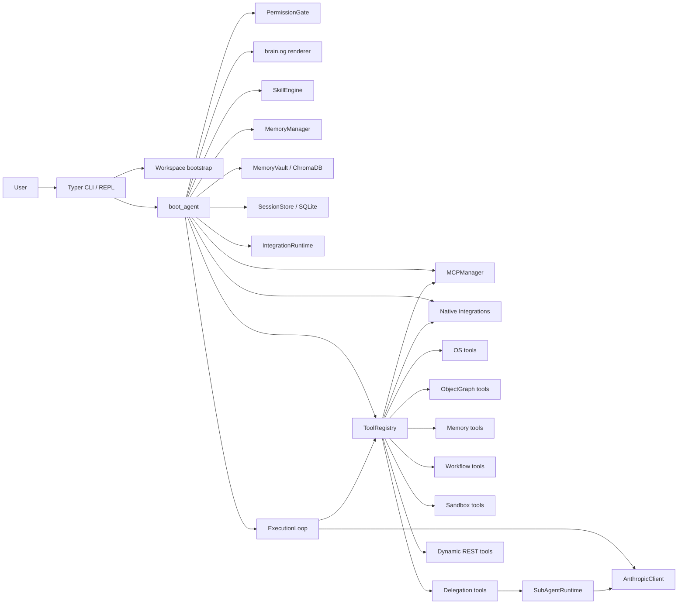
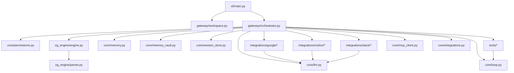
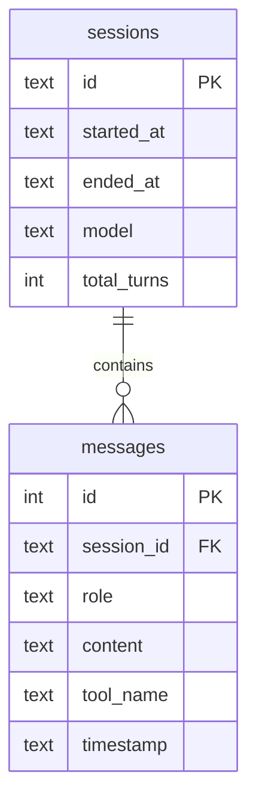
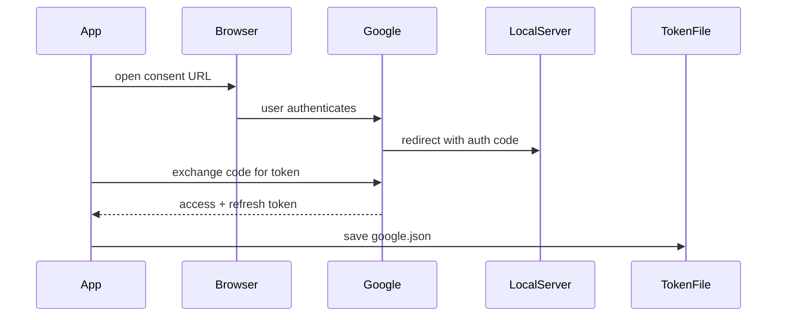

# Tokoboros Knowledge Transfer

Repository: OpenGigantic/tokoboros  
Branch: main  
Snapshot date: 2026-05-30  
Source basis: repository contents plus commit history on `main`

This document is written for an engineer who understands software engineering in general but knows nothing about Tokoboros specifically.

For every major concept, component, and workflow, this document tries to answer six questions:

1. What is it?
2. Why does it exist?
3. What problem does it solve?
4. How does it work internally?
5. What would break if it were removed?
6. What alternatives could have been used?

The codebase is young and opinionated. A lot of design is explicit in source comments and `.og` files, but some important behavior is only obvious when you connect several modules together. This document focuses on those connections.

## 1. Project Overview

### 1.1 What this project does

Tokoboros is a local, CLI-first autonomous agent runtime built around three core ideas:

- The agent should not read gigantic instruction files blindly; it should route into specific skill nodes inside ObjectGraph `.og` files.
- The main agent should not do every task itself; it should be able to spawn specialized sub-agents with isolated context windows.
- The agent should act through a real tool surface, not by pretending. That tool surface includes local file/terminal access, dynamic REST tools, native Google/Notion/Slack tools, and optionally MCP servers.

In practical terms, the user runs `tokoboros run`, types requests into a REPL, and the system:

- loads a local workspace under `~/.tokoboros/`
- parses `.og` role and skill files
- builds a system prompt from `brain.og`
- exposes tools to Anthropic Claude
- lets the model decide when to search skills, load skills, call tools, suspend workflows, or delegate work to sub-agents

### 1.2 Business problem it solves

#### What is the problem?

Modern agent systems tend to fail in three recurring ways:

- they stuff too much text into the prompt
- they mix unrelated tasks into one context window
- they rely on brittle prompt instructions instead of explicit execution surfaces

#### Why Tokoboros exists

Tokoboros exists to reduce token cost, reduce context pollution, and make autonomous execution more deterministic.

#### How it solves that problem

- `ObjectGraph` gives the agent indexed, queryable skill files instead of monolithic markdown.
- `ExecutionLoop` forces the model through a tool-calling ReAct-style cycle.
- `MemoryManager` compacts history and keeps a task ledger.
- `MemoryVault` separates long-lived user facts from transient workspace facts.
- `delegate_task` lets the orchestrator offload noisy or specialized work into a separate loop.
- `PermissionGate` constrains device access up front.

#### What breaks if this problem is not solved?

Without these design choices, Tokoboros would devolve into a standard chat wrapper around Claude with expensive prompts, weak state handling, and unsafe local execution.

#### Alternatives

- Plain markdown skill files with semantic search embeddings
- Traditional agent frameworks like LangChain/CrewAI/AutoGen
- Server-side orchestration with a workflow engine
- A pure rule engine without LLM routing

Tokoboros explicitly chooses local-first, prompt-cached, LLM-tool-driven orchestration instead.

### 1.3 Target users

Primary users are power users and developers who want a local autonomous agent that can interact with:

- their filesystem
- their terminal
- Google Workspace
- Notion
- Slack
- arbitrary REST APIs defined in `.og` files

The design assumes a technically comfortable user who is willing to grant device permissions and connect external services.

### 1.4 Core use cases

#### Use case: local engineering assistant

What it is: a coding-oriented local agent that can read files, write files, run commands, and spawn a coder sub-agent.  
Why it exists: software tasks are tool-heavy and context-noisy.  
How it works: the orchestrator loads engineering role/skill instructions, then calls OS tools or delegates.  
What breaks if removed: Tokoboros becomes only a read-only conversational assistant.  
Alternative: embed everything into the main prompt and use one agent only.

#### Use case: connected workspace assistant

What it is: a tool-driven assistant for Gmail, Calendar, Drive, Docs, Sheets, Contacts, Meet, Notion, and Slack.  
Why it exists: connected tools are where autonomous assistants become useful.  
How it works: native integration modules register first-class tools, or `.og` files generate REST tools dynamically.  
What breaks if removed: workflows like inbox cleanup, meeting follow-up, and briefing generation disappear.  
Alternative: use MCP-only integrations or scripts.

#### Use case: dynamic API wrapper platform

What it is: a runtime that turns `::api[...]` blocks in `.og` files into live Python tools.  
Why it exists: users should be able to add external capabilities without writing Python.  
How it works: `UniversalRestAdapter` reads parsed API definitions from every node and registers tool closures.  
What breaks if removed: most of the `general/*.og` shipped skills stop doing anything real.  
Alternative: hard-code each external API in Python.

### 1.5 Real-world examples

- "What is the weather in Tokyo?" -> search skill -> load `core_weather` -> call dynamic REST tool `fetch_weather` -> summarize JSON.
- "Read recent urgent emails and summarize them" -> use native Gmail tools.
- "Create a morning briefing" -> run the `morning_briefing` skill, which orchestrates Google tools plus weather and then suspends the workflow.
- "Refactor this module" -> main orchestrator decides to call `delegate_task(role="coder", ...)`.
- "Open a GitHub issue" -> load the GitHub skill and call the dynamic tool `create_github_issue` with a vault-provided token.

### 1.6 History and evolution of the project

The git history is extremely short and matters for how you should interpret the architecture.

#### Observed history

- Commit `d2f1867` is the initial commit and introduced almost the entire codebase in one shot: CLI, core engine, memory, parser, integrations, default skills, and documentation.
- Commit `c95fe27` renamed "GraphMark" terminology to "ObjectGraph" in the documentation.

#### Why this matters

This repository has not evolved through many refactoring cycles yet. Most architectural boundaries are intentional, but they have not been pressure-tested by long-term iteration, test hardening, or CI-driven cleanup.

#### Practical takeaway

Treat this codebase as a coherent first-generation architecture rather than a mature system that has been repeatedly simplified over time.

### 1.7 Major architectural decisions

| Decision | What and why | How it works | What breaks if removed | Alternatives |
| --- | --- | --- | --- | --- |
| CLI-first local runtime | The product is a terminal application, not a server. This avoids hosting complexity and aligns with local device access. | Typer command -> REPL in `src/tokoboros/cli/main.py`. | No interactive local agent, no permission-gated device operations. | FastAPI service, Electron app, VS Code extension first. |
| ObjectGraph skill format | Skills are structured `.og` files instead of plain markdown. This exists to reduce token waste and make routing explicit. | `parse_og_file()` builds `OGFile` and `OGNode`; `SkillEngine` indexes keywords and resolves context. | Skill routing becomes much noisier and more expensive. | Markdown + embeddings, YAML runbooks, code-only tools. |
| ToolRegistry-based reasoning | The LLM acts through a fixed tool surface instead of freeform hidden behavior. | `ExecutionLoop` passes JSON schemas to Claude, then `ToolRegistry.execute()` runs the chosen handler. | Real execution becomes weaker and hallucination risk rises. | Custom planner/executor, manually scripted flows. |
| Permission gate | Device access must be explicitly constrained. | `PermissionGate` parses `device-permissions.og`, wraps OS tools, and injects constraints into the prompt. | Unsafe file and terminal operations become possible. | OS sandboxing only, per-tool confirmations, container-only runtime. |
| Split memory architecture | User identity facts should not be drowned out by workspace noise. | `MemoryManager` handles active context; `MemoryVault` stores `core_memory`, `user_profile`, `agent_profile`, `delegation_log`; `SessionStore` persists sessions. | Context quality degrades over time and cross-session continuity disappears. | Single vector store, no long-term memory, event-sourced transcript only. |
| Sub-agent delegation | The orchestrator should stay context-clean during deep tasks. | `delegate_task` builds a scoped registry and runs `SubAgentRuntime` against a role `.og` file. | Complex tasks pollute the main loop and become harder to manage. | One big agent, workflow engine with separate tasks, message bus. |
| Multiple integration modes | The platform should support both first-party and user-defined capabilities. | Native Python integrations, dynamic REST adapter, classic `integration/env` nodes, and MCP support coexist. | Capability expansion becomes much narrower. | MCP-only, REST-only, SDK-only. |
| Prompt caching optimization | Anthropic prompt caching is treated as a first-class cost lever. | `AnthropicClient` marks the system prompt and final tool schema as `cache_control: ephemeral`. `AgentSession` keeps a frozen memory snapshot. | Token cost and latency increase on repeated turns. | No caching, provider-agnostic abstraction with fewer optimizations. |

### 1.8 Architecture diagram



## 2. Repository Structure

This repository has two kinds of assets:

- Python runtime code under `src/tokoboros/`
- declarative ObjectGraph assets under `src/tokoboros/default_skills/`

The most important structural fact is that first boot copies the shipped `.og` files into `~/.tokoboros/skills/` and `~/.tokoboros/brain.og`. After that, the runtime reads the user-local copies, not the repository files. That is a crucial debugging and product-behavior detail.

### 2.1 Root files

| Path | Purpose | Why it exists | Runtime impact / what breaks if removed | Alternatives |
| --- | --- | --- | --- | --- |
| `.gitignore` | Ignore local/runtime artifacts. | Prevents committing caches, virtualenv artifacts, and workspace byproducts. | Developer hygiene degrades; runtime still works. | Different ignore policy. |
| `CONTRIBUTING.md` | Human contribution contract. | Documents install, lint, test, and PR expectations. | Onboarding becomes tribal knowledge. | Wiki, issue template, docs site. |
| `LICENSE` | MIT license text. | Makes reuse/distribution explicit. | Legal ambiguity. | Apache-2.0, proprietary license. |
| `ObjectGraph_Complete_Specification.md` | Long-form ObjectGraph whitepaper/spec. | Explains why `.og` exists and how it should work. | Runtime still works; conceptual understanding drops sharply. | ADRs, smaller format spec, generated docs. |
| `README.md` | Product pitch, quick start, architecture sketch. | First contact for users and contributors. | Usability and discoverability degrade. | Docs site. |
| `pyproject.toml` | Package metadata, build config, dependencies, tool config. | Central Python packaging and dev-tool entry point. | Install/build/lint/test conventions disappear. | `setup.py`, split configs. |
| `src/` | Source root. | Uses src-layout packaging. | Package cannot be built/imported correctly. | Flat layout. |

### 2.2 Package map

```text
src/tokoboros/
  cli/
  core/
  default_skills/
  gateway/
  integrations/
  og_engine/
  tools/
```

### 2.3 `src/tokoboros/cli`

| File | What it is and why it exists | Key internals | Runtime impact if removed | Alternatives |
| --- | --- | --- | --- | --- |
| `src/tokoboros/cli/__init__.py` | Package marker with a short docstring. | No logic. | Nothing operational; only packaging clarity changes. | Omit file in modern namespace package layout. |
| `src/tokoboros/cli/main.py` | User-facing entry point and REPL. Exists so package install creates a usable command. | Typer app, Rich rendering, `run`, `onboard`, `permissions`, `reauth`, `_render_event`. | There is no usable application entry point. | Textual UI, web UI, service API. |

### 2.4 `src/tokoboros/gateway`

| File | What it is and why it exists | Key internals | Runtime impact if removed | Alternatives |
| --- | --- | --- | --- | --- |
| `src/tokoboros/gateway/__init__.py` | Package marker. | No logic. | None. | Namespace package. |
| `src/tokoboros/gateway/workspace.py` | Local workspace bootstrap and config loader. Exists because Tokoboros stores almost everything under `~/.tokoboros/`. | `ensure_workspace`, `load_config`, `load_brain`, permission wizard helpers. | First-run bootstrap, workspace config, and permission onboarding all break. | XDG/AppData config library, DB-backed config, installer-managed config. |
| `src/tokoboros/gateway/orchestrator.py` | Session assembly point. Exists to bind all subsystems into one runnable agent. | `boot_agent`, `AgentSession`, frozen snapshot, async prefetch, session shutdown, MCP configuration. | The product has no coherent runtime assembly. | Dependency injection container, service locator, explicit builder classes. |

### 2.5 `src/tokoboros/core`

| File | What it is and why it exists | Key internals | Runtime impact if removed | Alternatives |
| --- | --- | --- | --- | --- |
| `src/tokoboros/core/__init__.py` | Package marker. | No logic. | None. | Namespace package. |
| `src/tokoboros/core/constants.py` | Shared ObjectGraph tag constants. | `TAG_*`, `ROLE_*`. | Low runtime impact; mostly centralization loss. | Inline strings, enum classes. |
| `src/tokoboros/core/credential_vault.py` | Token store for Slack/Notion/GitHub-style secrets. Exists to avoid forcing users to edit env files manually. | Plain JSON load/save, interactive prompt on missing token. | Dynamic REST and native token-based integrations become harder to use. | OS keychain, encrypted vault, `.env`. |
| `src/tokoboros/core/errors.py` | Small custom exception module. | `OGParseError`, `OGValidationError`. | Mostly semantic clarity loss; parser currently does not lean heavily on them. | Built-in exceptions only. |
| `src/tokoboros/core/integrations.py` | Runtime for classic `.og`-defined `env` and `integration` nodes. Exists as a no-code bridge from declarative config to persistent SMTP/HTTP tools. | `IntegrationRuntime`, SMTP and HTTP setup, schema builder. | User-defined `integration`/`env` nodes cannot become live tools. | Only native integrations, only REST adapter, MCP only. |
| `src/tokoboros/core/llm.py` | LLM abstraction and Anthropic implementation. Exists to isolate provider details from the loop. | `Message`, `ToolCall`, `LLMResponse`, `BaseLLMClient`, `AnthropicClient`. | The agent cannot talk to Claude or expose tools. | OpenAI client, local model wrapper, direct SDK calls in loop. |
| `src/tokoboros/core/loop.py` | Core reasoning/execution engine. Exists to implement the observe-think-act cycle. | `ToolRegistry`, `ExecutionLoop`, `SuspendWorkflow`, `AgentException`. | No autonomous loop, no tool execution, no completion semantics. | State machine engine, planner/executor split, workflow DAG. |
| `src/tokoboros/core/mcp_client.py` | JSON-RPC stdio client for MCP servers. Exists to integrate external tools without hardcoding them. | `MCPServerConnection`, `MCPManager`. | MCP-based extensibility disappears. | HTTP-based MCP bridge, plugin SDK, native Python wrappers only. |
| `src/tokoboros/core/memory.py` | Active-session memory manager. Exists to control context growth and preserve continuity. | Task ledger, sliding window, pending compaction, background summarization/fact extraction. | Long sessions become expensive and messy. | Token counter only, truncation only, external memory service. |
| `src/tokoboros/core/memory_guard.py` | Prompt-injection scanner for stored memories. Exists because recalled memories are injected into prompts later. | Regex threat patterns and invisible Unicode detection. | Memory becomes a durable injection surface. | LLM-based sanitization, stricter structured schema. |
| `src/tokoboros/core/memory_provider.py` | Abstraction layer for pluggable memory backends. Exists as an architectural extension point. | `MemoryProvider`, `ChromaMemoryProvider`. | Very little today; current orchestrator still uses `MemoryVault` directly. | Remove until needed, or wire into orchestrator fully. |
| `src/tokoboros/core/memory_vault.py` | Long-term vector memory backed by ChromaDB. Exists for cross-turn and cross-session semantic recall. | Collections `core_memory`, `user_profile`, `agent_profile`, `delegation_log`; content-addressable IDs; guard-wrapped writes. | Long-term recall and delegation analytics vanish. | SQLite FTS, Qdrant, pgvector, plain JSON. |
| `src/tokoboros/core/models.py` | Older/parallel ObjectGraph model definitions. Exists as a design artifact for a richer OG reader/transpiler model, but is not used by the active runtime. | `OGIndex`, `OGNodeMeta`, `OGQueryResult`, etc. | Nothing in the current runtime breaks. | Delete or consolidate into `og_engine/parser.py`. |
| `src/tokoboros/core/oauth.py` | Browser-based Google OAuth token manager. Exists to make Google integrations usable without manual API key setup. | Local HTTP callback server, token refresh, token file storage. | Google Workspace integrations cannot authenticate themselves. | Google official SDKs, device code flow, service accounts. |
| `src/tokoboros/core/permissions.py` | Device access policy engine. Exists as the main security boundary for file, terminal, and MCP filesystem access. | Immutable rulesets, tier defaults, path/command checks, `.og` template generator. | Local execution becomes unsafe and unconstrained. | OS sandbox, per-action confirmation UX, container-only runtime. |
| `src/tokoboros/core/rest_adapter.py` | Dynamic REST tool generator. Exists so `.og` files can create real tools without Python code. | Parses node `api_defs`, builds tool schemas, injects headers/tokens, executes `httpx` requests. | Most shipped general skills and GitHub skill stop being executable. | Hard-code APIs in Python, external plugin system. |
| `src/tokoboros/core/sandbox.py` | Ephemeral Python execution environment using `uv`. Exists for code/data tasks that should not pollute the host environment. | `SandboxExecutor`, execution hashing, isolated env vars. | `python_sandbox` tool disappears. | Docker, subprocess + venv, remote code runner. |
| `src/tokoboros/core/session_store.py` | SQLite persistence for session transcripts. Exists for cross-session search and lightweight auditability. | Session/message tables, WAL mode, `search_sessions`. | Past-session recall and session analytics disappear. | JSONL logs, Postgres, embedded FTS engine. |
| `src/tokoboros/core/sub_agent.py` | Isolated delegated-agent runtime. Exists so the orchestrator can offload tasks without contaminating its own context. | `SubAgentRuntime`, `SubAgentMemory`, `PromptBuilder`, `RoleResolver`, `SubAgentReport`. | Delegation design collapses. | External worker service, reusable orchestration tasks, same-loop delegation. |

### 2.6 `src/tokoboros/og_engine`

| File | What it is and why it exists | Key internals | Runtime impact if removed | Alternatives |
| --- | --- | --- | --- | --- |
| `src/tokoboros/og_engine/__init__.py` | Package marker. | No logic. | None. | Namespace package. |
| `src/tokoboros/og_engine/parser.py` | ObjectGraph lexical parser. Exists to turn `.og` source text into structured models. | `OGFile`, `OGNode`, regex-based block parsing, file-level and node-level tag parsers. | Skills, roles, permissions, and integration definitions cannot be loaded. | YAML/JSON parser, PEG parser, markdown AST with extensions. |
| `src/tokoboros/og_engine/engine.py` | In-memory skill index and renderer. Exists to search and resolve skill nodes cheaply. | `SkillEngine`, keyword index, recursive dependency resolution, skill usage tracking. | `search_skills`, `load_skill`, native role lookup, and integration discovery all break. | Embedding search, SQLite index, Lucene-like index. |

### 2.7 `src/tokoboros/tools`

| File | What it is and why it exists | Key internals | Runtime impact if removed | Alternatives |
| --- | --- | --- | --- | --- |
| `src/tokoboros/tools/__init__.py` | Package marker. | No logic. | None. | Namespace package. |
| `src/tokoboros/tools/delegation_tools.py` | LLM-facing wrapper for sub-agent spawning. Exists to expose delegation as a tool instead of hardcoded planner logic. | `delegate_task`, `list_roles`, scoped registry builder, persistence thread. | Orchestrator cannot spawn specialized workers. | Planner-side hidden delegation. |
| `src/tokoboros/tools/memory_tools.py` | LLM-facing memory API. Exists to expose save/search/delete operations to the model. | `core_*` memory tools, cross-session search tool. | The LLM cannot persist or recall user/workspace/session context directly. | Hidden memory writes only, no memory tools. |
| `src/tokoboros/tools/og_tools.py` | LLM-facing skill search/load API. Exists because skills are the primary declarative behavior layer. | `search_skills`, `list_skills`, `load_skill`. | The agent cannot exploit `.og` skill files during execution. | Bake all skills into prompt, retrieval middleware. |
| `src/tokoboros/tools/os_tools.py` | Local file and terminal tools. Exists because local agency requires device I/O. | `read_file`, `write_file`, `run_terminal_command`, gated and raw implementations. | The agent cannot touch the host machine. | Container exec, remote tool server, VS Code APIs only. |
| `src/tokoboros/tools/sandbox_tools.py` | LLM-facing sandbox wrapper. Exists to make isolated Python execution accessible as a tool. | `python_sandbox`. | Data-analysis/code-exec jobs must use terminal or disappear. | Notebook runner, remote compute worker. |
| `src/tokoboros/tools/workflow_tools.py` | Workflow control tool family. Exists so long-running skills can pause intentionally. | `core_suspend_workflow`. | Monitoring or approval workflows cannot express pause points. | Explicit state machine outside LLM loop. |

### 2.8 `src/tokoboros/integrations/google`

| File | What it is and why it exists | Key internals | Runtime impact if removed | Alternatives |
| --- | --- | --- | --- | --- |
| `src/tokoboros/integrations/google/__init__.py` | Google integration hub/facade. Exists to aggregate scopes and register all Google tools. | `GoogleIntegrationHub`. | Native Google tooling disappears. | Instantiate services ad hoc per tool family. |
| `src/tokoboros/integrations/google/service.py` | Abstract service contract. | `GoogleService`. | Shared contract disappears; runtime still possible but less structured. | Duck typing only. |
| `src/tokoboros/integrations/google/client.py` | Authenticated HTTP wrapper for Google APIs. | `GoogleHTTPClient`, lazy headers, `get/post/patch/upload_multipart/delete`. | Every Google service must reimplement auth and requests. | Official Google SDKs, per-service HTTP wrappers. |
| `src/tokoboros/integrations/google/gmail.py` | Gmail tool family. | Send, list, search, draft, reply, archive, label, batch categorize, read thread. | Email workflows disappear. | Gmail MCP, direct SMTP/IMAP, user scripts. |
| `src/tokoboros/integrations/google/calendar.py` | Calendar tool family. | Create/list/update/delete events, free-busy scan. | Scheduling workflows disappear. | Calendar MCP, official SDK. |
| `src/tokoboros/integrations/google/drive.py` | Drive file-management tool family. | Search, create folder, upload, move, share, trash. | File automation in Drive disappears. | Drive MCP, official SDK. |
| `src/tokoboros/integrations/google/docs.py` | Docs tool family. | Create, read, append text. | Document workflows disappear. | Docs MCP, official SDK. |
| `src/tokoboros/integrations/google/sheets.py` | Sheets tool family. | Create sheet, append row, read range. | Spreadsheet automation disappears. | Sheets MCP, official SDK. |
| `src/tokoboros/integrations/google/contacts.py` | Contacts tool family. | Search, create, update, list, delete contacts. | Contact resolution workflows disappear. | People API wrapper elsewhere, Google MCP. |
| `src/tokoboros/integrations/google/meet.py` | Meet monitoring/transcript daemon. | `google_monitor_meeting`, polling thread, transcript storage into `MemoryVault`. | Meeting-note capture disappears. | Local audio/STT, Meet SDK, manual notes. |

### 2.9 `src/tokoboros/integrations/notion`

| File | What it is and why it exists | Key internals | Runtime impact if removed | Alternatives |
| --- | --- | --- | --- | --- |
| `src/tokoboros/integrations/notion/__init__.py` | Re-export package facade. | `__all__` exports. | Low impact; imports become noisier. | Import modules directly. |
| `src/tokoboros/integrations/notion/service.py` | Shared Notion HTTP client wrapper. | Token retrieval, headers, `_get/_post/_patch`. | Notion services must duplicate auth logic. | Official Notion SDK. |
| `src/tokoboros/integrations/notion/pages.py` | Notion page CRUD and markdown-to-block conversion. | `create_page`, `_parse_markdown_to_blocks`, `read_page_blocks`, append/archive methods. | Page-oriented Notion workflows disappear. | SDK, richer markdown parser, MCP. |
| `src/tokoboros/integrations/notion/databases.py` | Workspace search and database query tools. | `notion_search_workspace`, `notion_query_database`. | Database discovery/listing disappears. | SDK or MCP. |

### 2.10 `src/tokoboros/integrations/slack`

| File | What it is and why it exists | Key internals | Runtime impact if removed | Alternatives |
| --- | --- | --- | --- | --- |
| `src/tokoboros/integrations/slack/__init__.py` | Re-export package facade. | `__all__` exports. | Low impact. | Direct imports. |
| `src/tokoboros/integrations/slack/service.py` | Shared Slack API wrapper. | `_get`, `_post`, `_post_multipart`, header assembly. | Slack services duplicate auth logic. | Slack SDK. |
| `src/tokoboros/integrations/slack/chat.py` | Channel/thread messaging tools. | Send message, upload file, read channel/thread, add reaction. | Slack chat workflows disappear. | Slack SDK, MCP. |
| `src/tokoboros/integrations/slack/workspace.py` | Workspace discovery tools. | Search messages, list channels. | Slack discovery/search workflows disappear. | Slack SDK, MCP. |

### 2.11 `src/tokoboros/default_skills`

#### Core shipped `.og` files

| File | What it is and why it exists | Runtime impact if removed | Alternatives |
| --- | --- | --- | --- |
| `src/tokoboros/default_skills/brain.og` | The orchestrator's identity and operating rules. Exists because prompt instructions are treated as structured data. | The main agent loses its persona, behavior rules, and tool philosophy. | Hardcoded system prompt in Python. |
| `src/tokoboros/default_skills/core_integrations.og` | Declares built-in `native_integration` nodes for Google, Slack, Notion. | Native integrations are not discovered on boot. | Hardcode these in Python. |

#### General skills

| File | Purpose | Why it exists | Runtime impact if removed |
| --- | --- | --- | --- |
| `src/tokoboros/default_skills/general/currency.og` | Dynamic currency conversion via Frankfurter API. | Example and utility skill. | `convert_currency` tool is not generated. |
| `src/tokoboros/default_skills/general/dictionary.og` | Dictionary/thesaurus lookup via Free Dictionary API. | Deterministic lexical lookup. | `lookup_word` tool is not generated. |
| `src/tokoboros/default_skills/general/finance.og` | Crypto price lookup via CoinGecko. | External financial data without hallucination. | `fetch_crypto_price` tool disappears. |
| `src/tokoboros/default_skills/general/flight_radar.og` | Local airspace lookup via OpenSky. | Real-time aviation example skill. | `fetch_local_airspace` tool disappears. |
| `src/tokoboros/default_skills/general/math_engine.og` | Deterministic math via MathJS API. | Outsource non-trivial calculations from the LLM. | `evaluate_math` tool disappears. |
| `src/tokoboros/default_skills/general/network.og` | IP lookup via ipapi. | Network intelligence without custom code. | `lookup_ip` tool disappears. |
| `src/tokoboros/default_skills/general/qr_creator.og` | QR-code creation workflow using shell `curl`. | Demonstrates a non-REST skill that orchestrates OS tools. | No built-in QR workflow. |
| `src/tokoboros/default_skills/general/translator.og` | Translation via MyMemory API. | Deterministic translation path. | `translate_text` tool disappears. |
| `src/tokoboros/default_skills/general/weather.og` | Weather lookup via wttr.in. | Canonical example of skill -> REST tool -> summary flow. | `fetch_weather` tool disappears. |
| `src/tokoboros/default_skills/general/wiki.og` | Wikipedia summary lookup. | Fast factual backgrounding. | `fetch_wiki_summary` tool disappears. |

#### Google workflow skills

| File | Purpose | Why it exists | Runtime impact if removed |
| --- | --- | --- | --- |
| `src/tokoboros/default_skills/google/inbox_sentinel.og` | Inbox-monitoring workflow. | Demonstrates chained native-tool workflows. | No shipped inbox-monitoring blueprint. |
| `src/tokoboros/default_skills/google/meeting_copilot.og` | Meeting prep/follow-up workflow. | Demonstrates Google-tool orchestration. | No shipped meeting-assistant blueprint. |
| `src/tokoboros/default_skills/google/morning_briefing.og` | Daily briefing workflow. | Demonstrates multi-tool orchestration plus workflow suspension. | No shipped morning briefing blueprint. |
| `src/tokoboros/default_skills/google/receipt_sweeper.og` | Receipt extraction/organization workflow. | Demonstrates Gmail + Drive automation. | No shipped expense-cleanup workflow. |
| `src/tokoboros/default_skills/google/travel_organizer.og` | Travel extraction/organization workflow. | Demonstrates cross-tool personal-assistant workflow. | No shipped travel-organizer blueprint. |

#### Notion workflow skills

| File | Purpose | Why it exists | Runtime impact if removed |
| --- | --- | --- | --- |
| `src/tokoboros/default_skills/notion/notion_brain_dump.og` | Capture-to-Notion workflow. | Demonstrates personal knowledge capture. | No shipped Notion inbox workflow. |
| `src/tokoboros/default_skills/notion/project_kickoff.og` | Project kickoff automation. | Demonstrates Notion-centered team workflow. | No shipped kickoff blueprint. |
| `src/tokoboros/default_skills/notion/weekly_review.og` | Weekly review workflow. | Demonstrates reflective planning flow. | No shipped review blueprint. |

#### Role blueprints

| File | Purpose | Why it exists | Runtime impact if removed |
| --- | --- | --- | --- |
| `src/tokoboros/default_skills/roles/analyst.og` | Analyst sub-agent persona and rules. | Gives delegation a data-analysis role. | `delegate_task(role="analyst")` loses its default blueprint. |
| `src/tokoboros/default_skills/roles/coder.og` | Coder sub-agent persona and rules. | Gives delegation a software-engineering role. | `delegate_task(role="coder")` loses its default blueprint. |
| `src/tokoboros/default_skills/roles/devops.og` | DevOps sub-agent persona and rules. | Gives delegation an ops role. | `delegate_task(role="devops")` loses its default blueprint. |
| `src/tokoboros/default_skills/roles/emailer.og` | Emailer sub-agent persona and rules. | Gives delegation a writing/sending role. | `delegate_task(role="emailer")` loses its default blueprint. |
| `src/tokoboros/default_skills/roles/researcher.og` | Researcher sub-agent persona and rules. | Gives delegation a research role. | `delegate_task(role="researcher")` loses its default blueprint. |

#### Slack and technical skills

| File | Purpose | Why it exists | Runtime impact if removed |
| --- | --- | --- | --- |
| `src/tokoboros/default_skills/slack/daily_standup.og` | Standup-generation workflow. | Demonstrates Slack-centric ritual automation. | No shipped standup blueprint. |
| `src/tokoboros/default_skills/slack/dnd_coordinator.og` | DnD coordination workflow. | Demonstrates hobby/community orchestration. | No shipped DnD coordinator. |
| `src/tokoboros/default_skills/slack/urgent_escalator.og` | Urgent escalation workflow. | Demonstrates message-monitoring/escalation. | No shipped escalation blueprint. |
| `src/tokoboros/default_skills/technical/github.og` | GitHub issue creation skill. | Demonstrates token-backed dynamic REST tooling. | `create_github_issue` tool disappears. |

## 3. Architecture Deep Dive

### 3.1 Runtime component model



### 3.2 Request flow

#### Request-flow definition

The request flow is not HTTP. It is a local interactive loop:

`User input -> REPL -> AgentSession.chat -> ExecutionLoop -> ToolRegistry -> Tool handlers -> assistant output`

#### Why the request flow exists

The system is designed as a local agent shell, not a web app.

#### Request-flow internals

1. `Prompt.ask()` captures a user string.
2. `AgentSession.chat()` builds the dynamic system prompt and appends the user message to memory.
3. `ExecutionLoop.run()` asks Claude for either text and/or tool calls.
4. Tool calls are executed synchronously through `ToolRegistry.execute()`.
5. Tool results are appended to memory as `tool_result` blocks.
6. The loop repeats until the model emits no further tool calls.

#### What breaks without the request flow

There is no product. The rest of the repo is supporting machinery around this loop.

#### Request-flow alternatives

- HTTP request/response API
- job queue + worker architecture
- event-driven agent runtime with persisted state machine

### 3.3 Data flow

#### Inbound data

- user text from the terminal
- config files from `~/.tokoboros/`
- `.og` definitions from `~/.tokoboros/skills/`
- tokens from env vars or vault files

#### Internal data transformations

- raw `.og` text -> `OGFile` / `OGNode`
- natural-language query -> keyword match list via `SkillEngine.search`
- tool schemas + message history -> Anthropic tool call response
- tool results -> `tool_result` content blocks in memory
- finished turns -> vector facts and SQLite transcript rows

#### Outbound data

- console-rendered Markdown response
- HTTP requests to Google/Notion/Slack/REST APIs
- optional filesystem and terminal side effects
- ChromaDB and SQLite persistence

### 3.4 Control flow

Tokoboros uses centralized orchestration rather than distributed message passing.

- `boot_agent()` wires dependencies together.
- `ExecutionLoop` controls the active turn.
- tool handlers are synchronous and return strings.
- background threads are used only for prefetch, memory sync/flush, delegation persistence, and Meet monitoring.

### 3.5 Event flow

There is no enterprise event bus. The event model is local and callback-driven.

- `ExecutionLoop` emits `thinking`, `tool_call`, `tool_result`, `text_chunk`, and `compaction` events through `on_event`.
- `cli/main.py::_render_event` turns those into Rich UI panels.
- `delegate_task` emits `delegation_start` and `delegation_complete`, but the current CLI renderer does not have dedicated handlers for those event types.
- background threads perform work out of band but do not publish to a central queue.

### 3.6 Startup sequence

```mermaid
sequenceDiagram
    participant User
    participant CLI as cli/main.py
    participant WS as gateway/workspace.py
    participant BOOT as gateway/orchestrator.py
    participant PG as PermissionGate
    participant SE as SkillEngine
    participant MV as MemoryVault
    participant SS as SessionStore
    participant LOOP as ExecutionLoop

    User->>CLI: tokoboros run
    CLI->>WS: ensure_workspace()
    CLI->>WS: ensure_device_permissions()
    CLI->>BOOT: boot_agent(on_event)
    BOOT->>PG: PermissionGate(device-permissions.og)
    BOOT->>WS: load_config(), load_brain(), get_skills_dir()
    BOOT->>SE: load_directory(~/.tokoboros/skills)
    BOOT->>MV: create Chroma collections
    BOOT->>SS: open SQLite sessions.db
    BOOT->>LOOP: construct loop with llm client + tool registry
    BOOT-->>CLI: AgentSession
    CLI-->>User: REPL ready
```

### 3.7 Shutdown sequence

1. User types `exit` or `quit`.
2. `cli/main.py` calls `agent.shutdown()`.
3. `AgentSession.shutdown()` ends the SQLite session and closes the DB connection.
4. `IntegrationRuntime.shutdown()` tries to close SMTP/HTTP-ish connections.
5. `MCPManager.shutdown()` terminates subprocess servers.

There is no explicit flush for `MemoryVault`; Chroma's persistent client manages itself.

## 4. Build System

### 4.1 Build tools used

| Tool | What it is | Why it exists | How used here | Alternatives |
| --- | --- | --- | --- | --- |
| Hatchling | Python build backend. | Simple PEP 517 packaging. | `build-backend = "hatchling.build"`. | setuptools, poetry-core, pdm-backend. |
| uv | Package/env/project manager used in docs and workflows. | Fast lock+sync workflow with integrated venv management. | `uv sync` and `uv sync --extra dev`. | poetry, pipx, pdm. |
| Ruff | Linter/formatter. | Fast lint/format pass. | `ruff check src/`, `ruff format src/`. | flake8 + black + isort. |
| MyPy | Static type checker. | Intended type safety. | `mypy src/tokoboros/`. | pyright, pyre. |
| Pytest | Test runner. | Intended test harness. | `pytest`. | unittest, nose. |

### 4.2 Compilation and bundling process

This project is interpreted Python. There is no TypeScript transpilation, JavaScript bundling, or compiled binary build.

#### Inputs

- `pyproject.toml`
- Python source under `src/tokoboros/`
- README for package metadata

#### Outputs

- local synced project environment when using `uv sync`
- standard wheel/sdist when using a PEP 517 builder
- console script `tokoboros`

#### Internal mechanism

- `project.scripts` maps `tokoboros` to `tokoboros.cli.main:app`
- `tool.hatch.build.targets.wheel.packages = ["src/tokoboros"]` tells Hatchling what to package
- there are no code generation steps during build

### 4.3 Build commands

| Command | Inputs | Outputs | Internal mechanism | Notes |
| --- | --- | --- | --- | --- |
| `uv sync` | source tree, pyproject | synced local environment + package install | uv resolves dependencies, writes lock data, and syncs env | Default local install path. |
| `uv sync --extra dev` | same + dev extras | synced env + pytest/ruff/mypy deps | same with optional `dev` extra | Contributor setup path. |
| `uv run ruff check src/` | source tree | lint findings | Ruff static analysis via uv-managed env | No repo automation runs it for you. |
| `uv run ruff format src/` | source tree | reformatted files | Ruff formatter via uv-managed env | Optional/manual. |
| `uv run mypy src/tokoboros/` | source tree | type findings | MyPy static analysis via uv-managed env | Strict mode configured, but enforcement is manual. |
| `uv run pytest` | expected `tests/` tree | test results | Pytest test discovery via uv-managed env | `tool.pytest.ini_options.testpaths = ["tests"]`. |

### 4.4 Generated runtime artifacts

These are not build artifacts, but they matter operationally:

| Artifact | Location | Why it exists |
| --- | --- | --- |
| User workspace | `~/.tokoboros/` | Central local state root |
| Brain prompt copy | `~/.tokoboros/brain.og` | User-local brain file loaded at runtime |
| Config | `~/.tokoboros/tokoboros.json` | Model/max token configuration |
| Permissions | `~/.tokoboros/device-permissions.og` | Device security policy |
| Local skills | `~/.tokoboros/skills/**/*` | User-local copies of built-in and custom skills |
| Memory vault | `~/.tokoboros/brain/chroma_vault` | Chroma persistence |
| Session DB | `~/.tokoboros/brain/sessions.db` | SQLite transcript persistence |
| Skill analytics | `~/.tokoboros/brain/skill_usage.json` | Load counts and stale-skill metadata |
| Vault tokens | `~/.tokoboros/vault.json` | Slack/Notion/GitHub-style tokens |
| OAuth tokens | `~/.tokoboros/tokens/google.json` | Google OAuth refresh/access tokens |
| Sandbox runs | `~/.tokoboros/sandbox/exec_<hash>/` | Isolated code execution payloads |

## 5. Dependency Analysis

### 5.1 Declared runtime dependencies

| Dependency | Purpose | Why chosen | Critical APIs used | What breaks if removed | Alternatives |
| --- | --- | --- | --- | --- | --- |
| `anthropic` | Claude SDK for text + tool calling. | The system is built explicitly around Anthropic prompt caching and tool use. | `anthropic.Anthropic(...).messages.create(...)` | The main and sub-agent loops cannot run. | OpenAI SDK, local model wrappers, LiteLLM. |
| `pydantic` | Structured runtime models. | Convenient typed models with validation and serialization. | `BaseModel`, `Field`, `model_dump()` | Parser and LLM message/type models lose structure. | dataclasses, attrs, marshmallow. |
| `typer` | CLI application layer. | Lightweight CLI on top of Click with type hints. | `Typer`, `Option`, command decorators | `tokoboros` command disappears. | Click, argparse. |
| `rich` | Terminal rendering. | High-quality REPL feedback and panels. | `Console`, `Panel`, `Markdown`, `Rule`, `Prompt`, `Table` | The UI becomes much less readable. | plain print, Textual, curses. |

### 5.2 Declared development dependencies

| Dependency | Purpose | Notes |
| --- | --- | --- |
| `pytest` | Intended test runner | No tests are currently committed. |
| `ruff` | Linting and formatting | Configured for line length 100 and a focused ruleset. |
| `mypy` | Static type checking | `strict = true`, but runtime code and actual annotations are not fully cleaned up. |

### 5.3 Build dependency

| Dependency | Purpose | Notes |
| --- | --- | --- |
| `hatchling` | Build backend | Standard PEP 517 builder for the package. |

### 5.4 Runtime dependencies used in code but not declared in `pyproject.toml`

This is one of the most important senior-engineer caveats in the repo.

| Dependency | Where used | Why it matters |
| --- | --- | --- |
| `httpx` | `core/oauth.py`, `core/rest_adapter.py`, `integrations/google/client.py`, `integrations/notion/service.py`, `integrations/slack/service.py`, `integrations/google/meet.py`, Slack upload path | Native integrations and dynamic REST tools depend on it. A fresh install from current `pyproject.toml` can fail at runtime without it. |
| `chromadb` | `core/memory_vault.py` | Long-term memory depends on it. Without it, booting the memory vault fails. |

### 5.5 External executables and non-Python prerequisites

| External dependency | Why it exists | What breaks if missing | Alternatives |
| --- | --- | --- | --- |
| `uv` | Required by `core/sandbox.py` for isolated code execution. | `python_sandbox` tool returns environment errors. | virtualenv, Docker, remote code runner. |
| `node` / `npm` / `npx` | Needed for many MCP server packages, though no MCP servers ship by default. | MCP integrations cannot start. | Python MCP servers, direct SDK integrations. |
| Browser | Needed for Google OAuth consent flow. | Google tools cannot authenticate. | Device code flow, service account. |
| `curl` | Referenced by `general/qr_creator.og` steps. | QR creation skill as written is incomplete on hosts without curl. | Pure Python download code, dynamic REST adapter that saves binary content. |

## 6. Entry Points

### 6.1 User-facing entry points

| Entry point | Execution path | What it does | What breaks if removed |
| --- | --- | --- | --- |
| `tokoboros` console script | `pyproject.toml -> tokoboros.cli.main:app` | Starts Typer app | Package install yields no command |
| `tokoboros run` | `cli/main.py::run()` | Boots workspace and enters REPL | No interactive runtime |
| `tokoboros onboard` | `cli/main.py::onboard()` | Creates `~/.tokoboros/` layout | First-run bootstrap becomes manual |
| `tokoboros permissions` | `cli/main.py::permissions()` | View/reset/tweak `device-permissions.og` | Security UX becomes manual file editing only |
| `tokoboros reauth` | `cli/main.py::reauth()` | Deletes `vault.json` | Credential reset becomes manual |

### 6.2 Internal runtime entry points

| Entry point | Why it exists | Internal path |
| --- | --- | --- |
| `boot_agent()` | Central composition root | `src/tokoboros/gateway/orchestrator.py` |
| `AgentSession.chat()` | Turn-level orchestration | `src/tokoboros/gateway/orchestrator.py` |
| `ExecutionLoop.run()` | ReAct loop | `src/tokoboros/core/loop.py` |
| `delegate_task` tool | Sub-agent spawning | `src/tokoboros/tools/delegation_tools.py` |
| Dynamic REST tool registration | `.og` `::api` -> tool closures | `src/tokoboros/core/rest_adapter.py` |
| Native tool registration | Google/Notion/Slack tool families | `src/tokoboros/integrations/*` |
| MCP tool registration | External server-discovered tools | `src/tokoboros/core/mcp_client.py` |

### 6.3 Configuration loading sequence

`tokoboros run` loads configuration in this order:

1. `ensure_workspace()` guarantees files exist.
2. `ensure_device_permissions()` ensures the permissions manifest exists.
3. `PermissionGate` loads `device-permissions.og`.
4. `load_config()` reads `~/.tokoboros/tokoboros.json`.
5. `load_brain()` parses `~/.tokoboros/brain.og` and renders it into prompt text.
6. `SkillEngine.load_directory()` reads `~/.tokoboros/skills/**/*.og`.

## 7. Runtime Execution Walkthrough

This section starts at program startup and follows the real code path.

### 7.1 First executed code

The effective entrypoint is the console script created from `pyproject.toml`:

```toml
[project.scripts]
tokoboros = "tokoboros.cli.main:app"
```

That means the first runtime object of interest is the Typer app in `src/tokoboros/cli/main.py`.

### 7.2 CLI boot path

Relevant excerpt:

```python
@app.command()
def run():
    ensure_workspace()
    ensure_device_permissions(console)
    agent: AgentSession = boot_agent(on_event=_render_event)
    ...
    while True:
        user_input = Prompt.ask("\n[bold cyan]You[/bold cyan]")
        response = agent.chat(user_input)
        console.print(Markdown(response))
```

Line-by-line behavior:

1. `ensure_workspace()` creates `~/.tokoboros/`, `skills/`, and `sessions/`, copies built-in skills if the skills directory is empty, writes `brain.og` if absent, and writes default `tokoboros.json` if absent.
2. `ensure_device_permissions(console)` checks for `device-permissions.og`; if absent, it launches the interactive wizard.
3. `boot_agent(on_event=_render_event)` constructs the entire runtime.
4. The CLI enters an infinite REPL loop.
5. Each prompt becomes one call to `agent.chat()`.
6. `Markdown(response)` renders the model's final text as formatted terminal output.

### 7.3 `boot_agent()` assembly path

Relevant excerpt:

```python
permissions_file = get_workspace_dir() / "device-permissions.og"
gate = PermissionGate(permissions_file)

config = load_config()
brain_prompt = load_brain()

skill_engine = SkillEngine()
skills_dir = get_skills_dir()
skill_engine.load_directory(skills_dir)

integrations = IntegrationRuntime()
mcp_manager = MCPManager()
...
client = AnthropicClient(model=model_name, max_tokens=max_tokens)
memory = MemoryManager(max_active_messages=30)
tool_registry = ToolRegistry()
...
loop = ExecutionLoop(...)
session = AgentSession(...)
```

Detailed creation order:

1. `PermissionGate` is created first. This is deliberate; all later tool registration depends on it.
2. Local config JSON is read.
3. The local `brain.og` file is parsed and rendered into prompt text.
4. `SkillEngine` parses every `.og` file in `~/.tokoboros/skills/` and indexes all nodes.
5. `IntegrationRuntime` scans for `env` and `integration` nodes. In the shipped default skills, there are no such nodes, so this extension path is idle by default.
6. `MCPManager` scans for `mcp` nodes. Again, no built-in MCP nodes ship in the repo, so this path is also dormant by default.
7. Native integration nodes from `core_integrations.og` are detected, which causes boot-time construction of:
   - `GoogleIntegrationHub`
   - `NotionPages` and `NotionDatabases`
   - `SlackChat` and `SlackWorkspace`
8. The base system prompt is assembled from:
   - rendered brain prompt
   - a skill-awareness reminder if any skills were loaded
   - a live-tool reminder if integration or MCP tools are present
   - permission constraints from `PermissionGate`
9. `AnthropicClient` is created with the configured model and max tokens.
10. `MemoryManager` is created.
11. `ToolRegistry` is filled in this order:
    - OS tools
    - ObjectGraph tools
    - workflow tools
    - sandbox tools
    - dynamic REST tools from every parsed node
    - memory tools
    - session search tools
    - classic integration tools
    - MCP tools
    - delegation tools
    - native integration tools
12. `ExecutionLoop` is created.
13. `AgentSession` is created and then bound to `MemoryVault` and `SessionStore`.

### 7.4 `AgentSession.chat()` path

`AgentSession.chat()` exists to prepare the prompt envelope around the execution loop.

What it does each turn:

1. On first call only, build a frozen memory snapshot from:
   - `user_profile`
   - `agent_profile`
   - top semantic memory facts from `core_memory`
2. Pop any asynchronously prefetched context from the previous turn.
3. If no prefetch exists, do a synchronous semantic search on the current user input.
4. Build a dynamic system prompt consisting of:
   - current local time header
   - frozen snapshot
   - recalled context for this turn
   - original base system prompt
5. Add the user message to memory.
6. Run `ExecutionLoop.run()`.
7. Launch async prefetch for the next turn.
8. Log the user message and assistant response to SQLite.

### 7.5 `ExecutionLoop.run()` path

This is the real heart of the system.

Inside each iteration:

1. Apply any pending compaction from the previous skill switch.
2. Emit a `thinking` event.
3. Build the full system prompt by prepending the memory task ledger header if it exists.
4. Call `AnthropicClient.generate(...)` with message history and all tool schemas.
5. Convert the model response into mixed content blocks:
   - text blocks
   - `tool_use` blocks
6. Append the assistant message to memory.
7. If there were no tool calls:
   - trigger async fact extraction through `memory.sync_turn()`
   - add a task record to the ledger
   - return the final text response
8. If there were tool calls:
   - execute each through `ToolRegistry`
   - detect `load_skill` calls and switch the active skill in memory
   - append `tool_result` blocks as a synthetic user message
9. Repeat until completion or iteration limit.

### 7.6 What connections open during startup?

| Component | Opens connection at boot? | Notes |
| --- | --- | --- |
| `AnthropicClient` | No live network call yet | Just holds SDK client and API key |
| `MemoryVault` | Yes, local Chroma persistent client | Creates/opens collections immediately |
| `SessionStore` | Yes, local SQLite connection | Enables WAL mode immediately |
| `GoogleHTTPClient` | No token exchange until first request | Lazy auth |
| `NotionService` | Possibly prompts for token during object construction | Reads/stores token at init |
| `SlackService` | Possibly prompts for token during object construction | Reads/stores token at init |
| `IntegrationRuntime` classic SMTP/HTTP | Only if matching `.og` nodes exist | No built-in nodes ship |
| `MCPManager` | Only if matching `.og` nodes exist | No built-in nodes ship |

## 8. Request Lifecycle

The repo has no HTTP router, controller, service, repository, or database request stack in the usual web-framework sense. The real lifecycle is REPL-driven and tool-centric.

To make this concrete, trace the request: `What is the weather in London?`

### 8.1 Lifecycle table

| Step | File / method | What happens | Data transformation | Error handling |
| --- | --- | --- | --- | --- |
| 1 | `src/tokoboros/cli/main.py::run` | User enters text in REPL. | Raw terminal string -> `user_input`. | Empty input is skipped; Ctrl+C shuts down cleanly. |
| 2 | `src/tokoboros/gateway/orchestrator.py::AgentSession.chat` | Time header, frozen snapshot, and recalled context are added to the system prompt. | String -> enriched prompt context. | Vault recall failures are swallowed and treated as empty recall. |
| 3 | `src/tokoboros/core/loop.py::ExecutionLoop.run` | Claude gets message history + tool schemas and decides next action. | LLM output -> text and tool calls. | Loop limit raises `AgentException`. |
| 4 | `src/tokoboros/tools/og_tools.py::search_skills` | Model searches for relevant skill. | Query string -> JSON string listing matches like `core_weather`. | Returns friendly "No matching skills found" string. |
| 5 | `src/tokoboros/tools/og_tools.py::load_skill` | Model loads `core_weather`. | Skill name -> rendered skill context string. | Missing skill returns error string from `SkillEngine.resolve_context`. |
| 6 | `src/tokoboros/core/rest_adapter.py::dynamic_api_tool` for `fetch_weather` | Dynamic REST tool calls wttr.in. | Skill-defined schema args -> URL/headers -> HTTP response text/JSON string. | Returns `HTTP Error...`, `Request Error...`, or `Unexpected Error...` strings. |
| 7 | `src/tokoboros/core/loop.py` | Tool result is appended as a `tool_result` content block. | Raw tool output -> Anthropic-compatible message block. | Tool exceptions become strings inside `ToolRegistry.execute`. |
| 8 | `src/tokoboros/core/llm.py::AnthropicClient.generate` | Model synthesizes final natural-language response. | JSON/string tool output -> user-facing markdown. | If provider call fails, exception bubbles to CLI. |
| 9 | `src/tokoboros/core/memory.py::sync_turn` and `src/tokoboros/core/session_store.py::log_message` | Finished turn is summarized/persisted asynchronously and logged to SQLite. | Transcript -> semantic facts and session rows. | Extraction errors are swallowed; SQLite logging errors are swallowed by `AgentSession.chat`. |

### 8.2 Sequence diagram

```mermaid
sequenceDiagram
    participant User
    participant CLI
    participant Session as AgentSession
    participant Loop as ExecutionLoop
    participant OG as search_skills/load_skill
    participant REST as fetch_weather tool
    participant LLM as AnthropicClient
    participant Store as SessionStore/MemoryVault

    User->>CLI: "What is the weather in London?"
    CLI->>Session: chat(user_input)
    Session->>Loop: add user message + run()
    Loop->>LLM: generate(messages, tools, system_prompt)
    LLM-->>Loop: tool call search_skills
    Loop->>OG: search_skills("weather London")
    OG-->>Loop: [{"name": "core_weather", ...}]
    Loop->>LLM: tool_result(search_skills)
    LLM-->>Loop: tool call load_skill(core_weather)
    Loop->>OG: load_skill("core_weather")
    OG-->>Loop: rendered skill text
    Loop->>LLM: tool_result(load_skill)
    LLM-->>Loop: tool call fetch_weather(location="London")
    Loop->>REST: GET wttr.in/London?format=j1
    REST-->>Loop: JSON payload
    Loop->>LLM: tool_result(fetch_weather)
    LLM-->>Loop: final summary text
    Loop-->>Session: final response
    Session->>Store: log transcript + async fact extraction
    Session-->>CLI: final response
    CLI-->>User: rendered markdown
```

### 8.3 Why this matters for new engineers

If you come from a web-service background, do not look for `router -> controller -> service -> repository`. Tokoboros instead uses:

`REPL -> session assembler -> LLM loop -> tool registry -> tool handler -> external side effect`

The analogues are:

- router: Typer command + REPL loop
- controller: `AgentSession.chat()` and `ExecutionLoop.run()` together
- services: tool handlers and integration modules
- repository: `MemoryVault` and `SessionStore`
- database: ChromaDB + SQLite

## 9. Data Model Deep Dive

### 9.1 LLM conversation models (`src/tokoboros/core/llm.py`)

#### `Message`

| Field | Meaning | Constraints / notes |
| --- | --- | --- |
| `role` | Speaker role, usually `user` or `assistant` | Anthropic-style role semantics |
| `content` | Either a string or a list of content blocks | Tool iterations use list-of-dicts blocks |

Why it exists: standardizes history storage between the loop and provider.  
What breaks if removed: every module must handle provider-native message formats directly.  
Alternative: raw dicts or provider SDK types.

#### `ToolCall`

| Field | Meaning | Constraints / notes |
| --- | --- | --- |
| `id` | Unique tool invocation identifier | Used to pair `tool_use` with `tool_result` |
| `name` | Tool schema name | Must match a registered tool |
| `input` | Tool arguments | JSON-like dict |

#### `LLMResponse`

| Field | Meaning | Constraints / notes |
| --- | --- | --- |
| `content` | Final assistant text for this provider call | May be empty if the model only emitted tools |
| `tool_calls` | Requested tool invocations | Zero or more |

### 9.2 ObjectGraph parser models (`src/tokoboros/og_engine/parser.py`)

#### `OGIndexEntry`

| Field | Meaning | Why it matters |
| --- | --- | --- |
| `node_id` | The routed node name | Main lookup key |
| `node_type` | Step/concept/etc. | Gives routing semantics |
| `scope` | Visibility scope | Supports RBAC-style filtering |
| `confidence` | Trust/freshness hint | Lets a future engine prioritize safer nodes |
| `keywords` | Search terms | Powers `SkillEngine.search()` |

#### `OGFileMeta`

Important fields:

- `title`, `version`, `author`, `created`, `updated`: document identity
- `domain`: coarse classification
- `scope`: default access scope
- `tools`: role file declaration of tool patterns for sub-agent scoping
- `min_agent_version`, `checksum`: future-proofing / integrity hooks

#### `OGNode`

This is the most important content entity in the system.

| Field group | Meaning |
| --- | --- |
| `name`, `source_file` | Node identity and origin |
| `role`, `scope`, `keywords`, `requires`, `requires_auth` | Metadata edges parsed from `->[:key=value]` lines |
| `dense`, `full`, `summary` | Different information depths |
| `code_blocks`, `steps`, `list_items`, `table`, `warning`, `note`, `example`, `reference` | Structured content blocks |
| `assertions`, `edges`, `traverse` | Behavior and navigation semantics |
| `config`, `tool_def` | Integration/classic tool config |
| `api_defs` | Dynamic REST tool definitions |

Why it exists: it is the atomic unit of ObjectGraph knowledge.  
What breaks if removed: the entire skill/runtime model collapses.  
Alternative: one-file-per-skill or markdown headings without structure.

#### `OGFile`

Top-level parsed container:

- `meta`
- `index`
- `og_schema`
- `changelog`
- `nodes`

Why it exists: separates file-level routing metadata from node bodies.  
What breaks if removed: parser and sub-agent prompt building become much more awkward.  
Alternative: parallel sidecar metadata files.

### 9.3 Permission and security models (`src/tokoboros/core/permissions.py`)

| Model | Fields | Why it exists |
| --- | --- | --- |
| `PermissionResult` | `allowed`, `reason` | Standard denial/allow object returned by checks |
| `FilesystemRules` | allowed/blocked paths, write/delete booleans, size cap | Immutable FS policy snapshot |
| `TerminalRules` | enabled flag, allow/block command lists, timeout | Immutable terminal policy snapshot |
| `MCPRules` | filesystem enabled flag | Controls MCP filesystem startup |

These are frozen dataclasses on purpose. The design intent is that permissions are immutable after boot.

### 9.4 Memory and reporting models

| Model | File | Meaning |
| --- | --- | --- |
| `TaskRecord` | `src/tokoboros/core/memory.py` | One completed task in the active session ledger |
| `SandboxResult` | `src/tokoboros/core/sandbox.py` | Structured sandbox execution result |
| `SubAgentReport` | `src/tokoboros/core/sub_agent.py` | Compact handoff object from sub-agent to orchestrator |
| `SubAgentStatus` | `src/tokoboros/core/sub_agent.py` | `success`, `error`, `timeout` |

`SubAgentReport` fields are especially important:

| Field | Meaning | Why it matters |
| --- | --- | --- |
| `status` | terminal result | lets orchestrator decide retry/escalation |
| `summary` | compact result text | keeps main context small |
| `role` | role used | important for analytics and reasoning |
| `task` | original delegated task | preserves intent |
| `iterations` | loop steps used | performance/debug signal |
| `duration_seconds` | wall time | performance/debug signal |
| `token_estimate` | rough cost estimate | cost awareness |
| `metadata` | optional structured extra data | future extension point |

### 9.5 Legacy / unused models

`src/tokoboros/core/models.py` defines a second ObjectGraph model family (`OGNodeMeta`, `OGQueryResult`, `OGDeltaResult`, `OGSession`, etc.). In the current runtime snapshot, nothing imports or uses these types.

That means:

- they are part of the design story
- they are not part of the active execution story

## 10. Database Layer

Tokoboros does not have an application database in the normal CRUD sense. It has two local persistence layers:

- ChromaDB for semantic memory
- SQLite for session transcripts

### 10.1 ChromaDB layer (`src/tokoboros/core/memory_vault.py`)

#### ChromaDB definition

An embedded vector store rooted at `~/.tokoboros/brain/chroma_vault`.

#### Chroma collections

| Collection | Purpose | Why separate |
| --- | --- | --- |
| `core_memory` | general workspace facts | unbounded and noisy by nature |
| `user_profile` | user identity/preferences | bounded so important personal facts are not crowded out |
| `agent_profile` | agent behavioral directives | separate so agent self-instructions are curated independently |
| `delegation_log` | sub-agent outcomes | supports pattern recall and analytics |

#### Chroma write path

1. Content goes through `MemoryGuard`.
2. An ID is generated as `sha256(content)`.
3. The content is upserted with metadata `{category, timestamp}`.

Why this matters:

- duplicate facts are idempotent
- prompt-injection strings are blocked before persistence
- categories give coarse organizational structure

#### Chroma query patterns

- `semantic_search(query, top_k)` on `core_memory`
- `search_user_profile(query, top_k)` on `user_profile`
- `search_delegations(query, top_k, role=None)` on `delegation_log`

#### Chroma performance considerations

- The app delegates ANN/vector-search complexity to Chroma.
- User profile is capped at 25 entries, which prevents identity drift and prompt bloat.
- Delegation logging is backgrounded to avoid blocking the main loop.

#### What breaks without ChromaDB

- frozen memory snapshot
- semantic recall between turns
- auto-extracted workspace facts
- delegation history search

#### Chroma alternatives

- pgvector
- Qdrant/Pinecone
- SQLite FTS with no embeddings
- plain append-only logs with LLM summarization only

### 10.2 SQLite layer (`src/tokoboros/core/session_store.py`)

#### SQLite schema



#### Why SQLite exists here

The vector store is good for fuzzy recall, but not for audit-style transcript search. SQLite is a cheap local persistence layer for recent-history questions and forensic debugging.

#### SQLite indexes

- `idx_msg_session` on `messages(session_id)`
- `idx_msg_content` on `messages(content)`

#### SQLite query patterns

| Query | Purpose | Complexity notes | Optimization opportunities |
| --- | --- | --- | --- |
| session insert/update | create/end sessions | cheap point writes | already acceptable |
| message insert | transcript logging | append-heavy, WAL-friendly | batching if write volume increases |
| `search_sessions(query)` | cross-session substring search | effectively O(n) because `LIKE '%query%'` cannot use a normal prefix index well | move to FTS5 if transcript volume grows |
| `get_recent_sessions(limit)` | recent session metadata | cheap ordered read | adequate today |

#### SQLite migrations

There is no migration framework. Schema is created inline in `_init_schema()`.

What this means:

- schema changes are code changes
- upgrades require manual migration strategy if old DBs matter
- there is no version table

## 11. API Deep Dive

### 11.1 Inbound APIs

There are no inbound HTTP APIs and no REST endpoints exposed by Tokoboros itself.

That means there is no section to document of the form:

`/users -> controller -> service -> repository`

Instead, Tokoboros exposes an internal tool API to the LLM and then consumes outbound third-party APIs.

### 11.2 Core tool APIs exposed to the LLM

#### Skill-routing tools

| Tool | File / handler | Input schema | Response shape | Auth | Internal flow |
| --- | --- | --- | --- | --- | --- |
| `search_skills` | `src/tokoboros/tools/og_tools.py` | `{ query: string }` | JSON string list of name/role/keywords/source_file | none | `SkillEngine.search()` |
| `list_skills` | same | `{}` | JSON string list of loaded nodes | none | `SkillEngine.list_all_skills()` |
| `load_skill` | same | `{ name: string }` | rendered skill context string | none | `SkillEngine.resolve_context()` |

#### Local OS tools

| Tool | File / handler | Input schema | Response shape | Auth / authorization | Internal flow |
| --- | --- | --- | --- | --- | --- |
| `read_file` | `src/tokoboros/tools/os_tools.py` | `{ path }` | raw file text or error string | permission-gated | `PermissionGate.check_path(..., "read")` -> file read |
| `write_file` | same | `{ path, content }` | success/error string | permission-gated | `check_path(..., "write")` -> file write |
| `run_terminal_command` | same | `{ command, cwd? }` | stdout/stderr/exit-code string | permission-gated | `check_command()` -> subprocess run |

#### Memory tools

| Tool | Purpose | Notes |
| --- | --- | --- |
| `core_save_memory` | save workspace facts | queues background consolidation thread |
| `core_search_memory` | semantic search in `core_memory` | returns formatted text, not raw vectors |
| `core_delete_memory` | delete fact by ID | simple boolean-like string result |
| `core_save_user_profile` | save bounded identity facts | capped at 25 entries |
| `core_search_user_profile` | search user profile | includes capacity stats |
| `core_delete_user_profile` | delete identity fact | ID-based |
| `core_search_sessions` | substring search across SQLite transcripts | no FTS, returns snippets |

#### Workflow, sandbox, and delegation tools

| Tool | Purpose | File |
| --- | --- | --- |
| `core_suspend_workflow` | intentionally halt the active workflow | `src/tokoboros/tools/workflow_tools.py` |
| `python_sandbox` | isolated Python code execution with optional deps | `src/tokoboros/tools/sandbox_tools.py` |
| `delegate_task` | spawn a specialized sub-agent | `src/tokoboros/tools/delegation_tools.py` |
| `list_roles` | enumerate available delegation roles | `src/tokoboros/tools/delegation_tools.py` |

### 11.3 Dynamic REST APIs generated from shipped `.og` files

These are created at boot by `UniversalRestAdapter.register_node_apis()`.

| Tool | Source skill file | Method / endpoint | Purpose | Auth |
| --- | --- | --- | --- | --- |
| `convert_currency` | `src/tokoboros/default_skills/general/currency.og` | `GET https://api.frankfurter.app/latest?...` | fiat conversion | none |
| `lookup_word` | `src/tokoboros/default_skills/general/dictionary.og` | `GET https://api.dictionaryapi.dev/api/v2/entries/en/{word}` | dictionary lookup | none |
| `fetch_crypto_price` | `src/tokoboros/default_skills/general/finance.og` | `GET https://api.coingecko.com/api/v3/simple/price?...` | crypto pricing | none |
| `fetch_local_airspace` | `src/tokoboros/default_skills/general/flight_radar.og` | `GET https://opensky-network.org/api/states/all?...` | live airspace lookup | none |
| `evaluate_math` | `src/tokoboros/default_skills/general/math_engine.og` | `POST https://api.mathjs.org/v4/` | deterministic math | none |
| `lookup_ip` | `src/tokoboros/default_skills/general/network.og` | `GET https://ipapi.co/{ip_address}/json/` | IP intelligence | none |
| `translate_text` | `src/tokoboros/default_skills/general/translator.og` | `GET https://api.mymemory.translated.net/get?...` | translation | none |
| `fetch_weather` | `src/tokoboros/default_skills/general/weather.og` | `GET https://wttr.in/{location}?format=j1` | weather lookup | none |
| `fetch_wiki_summary` | `src/tokoboros/default_skills/general/wiki.og` | `GET https://en.wikipedia.org/api/rest_v1/page/summary/{title}` | encyclopedia summary | none |
| `create_github_issue` | `src/tokoboros/default_skills/technical/github.og` | `POST https://api.github.com/repos/{owner}/{repo}/issues` | GitHub issue creation | GitHub token from `CredentialVault` |

Important internal detail: the adapter injects a warning into each tool description telling the model it must call `load_skill('<node_name>')` first. This is meant to preserve behavioral instructions and safety assertions even though the raw REST tool exists.

### 11.4 Native Google tools

#### Gmail tools (`src/tokoboros/integrations/google/gmail.py`)

| Tool | Underlying API path | Purpose |
| --- | --- | --- |
| `google_send_email` | `/gmail/v1/users/me/messages/send` | send email |
| `google_list_emails` | `/gmail/v1/users/me/messages` + per-message GET | list inbox items |
| `google_search_emails` | `/gmail/v1/users/me/messages?q=...` + per-message GET | Gmail search |
| `google_create_draft` | `/gmail/v1/users/me/drafts` | draft email |
| `google_reply_thread` | thread read + send message with `threadId` | reply to thread |
| `google_read_email_thread` | `/gmail/v1/users/me/threads/{thread_id}` | read thread body |
| `google_archive_email` | message modify | remove `INBOX` label |
| `google_mark_email_read` | message modify | remove `UNREAD` label |
| `google_list_gmail_labels` | labels list | enumerate labels |
| `google_create_gmail_label` | labels create | create label |
| `google_categorize_email` | message modify | add label to message |
| `google_batch_categorize_emails` | batch modify | label many messages |

#### Calendar tools (`src/tokoboros/integrations/google/calendar.py`)

| Tool | Purpose | Notes |
| --- | --- | --- |
| `google_create_event` | create event, optionally with Meet link | expects ISO 8601 with timezone offset |
| `google_list_events` | list upcoming events | sorted by start time |
| `google_find_free_time` | free-busy analysis | returns busy windows, not a perfect slot solver |
| `google_update_event` | patch event fields | fetches event first, then patches |
| `google_delete_event` | delete event | direct delete |

#### Drive, Docs, Sheets, Contacts, Meet

| Tool family | Tools |
| --- | --- |
| Drive | `google_search_drive`, `google_create_folder`, `google_upload_file`, `google_move_file`, `google_share_file`, `google_trash_file` |
| Docs | `google_create_doc`, `google_read_doc`, `google_append_doc_text` |
| Sheets | `google_append_sheet_row`, `google_create_sheet`, `google_read_sheet` |
| Contacts | `google_search_contact`, `google_create_contact`, `google_update_contact`, `google_list_contacts`, `google_delete_contact` |
| Meet | `google_monitor_meeting` |

Authentication model: Google tools use OAuth through `OAuthManager`. The system aggregates all required scopes across service modules first, then requests/refreshes a token lazily.

### 11.5 Native Notion tools

| Tool | File | Purpose | Auth |
| --- | --- | --- | --- |
| `notion_create_page` | `src/tokoboros/integrations/notion/pages.py` | create page | token from `CredentialVault` |
| `notion_read_page` | same | read blocks/page contents | same |
| `notion_append_to_page` | same | append markdown-derived blocks | same |
| `notion_archive_page` | same | archive page | same |
| `notion_search_workspace` | `src/tokoboros/integrations/notion/databases.py` | global search | same |
| `notion_query_database` | same | list database pages | same |

### 11.6 Native Slack tools

| Tool | File | Purpose | Auth |
| --- | --- | --- | --- |
| `slack_send_message` | `src/tokoboros/integrations/slack/chat.py` | send message | token from `CredentialVault` |
| `slack_upload_file` | same | upload file via Slack v2 flow | same |
| `slack_read_channel` | same | read recent channel messages | same |
| `slack_read_thread` | same | read thread replies | same |
| `slack_add_reaction` | same | add emoji reaction | same |
| `slack_list_channels` | `src/tokoboros/integrations/slack/workspace.py` | channel discovery | same |
| `slack_search_messages` | same | workspace search | same |

### 11.7 Classic `.og` integration and MCP APIs

These are supported by code but not populated by the shipped default skills.

| Surface | What it is | Where it is wired |
| --- | --- | --- |
| `role=env` nodes | key/value env credential ingestion | `src/tokoboros/core/integrations.py` |
| `role=integration` nodes | SMTP/HTTP persistent integration definitions | `src/tokoboros/core/integrations.py` |
| `role=mcp` nodes | subprocess-based MCP server definitions | `src/tokoboros/core/mcp_client.py` and `src/tokoboros/gateway/orchestrator.py` |

Out of the box, only `role=native_integration` is actually present in the default `.og` set.

## 12. Event-Driven Components

### 12.1 What exists

Tokoboros is not queue-based, but it does have local asynchronous/event-like behavior:

- execution events emitted to the UI callback
- background memory prefetch
- background fact extraction
- background context summarization/flush
- background delegation persistence
- background Google Meet transcript polling
- workflow suspension

### 12.2 What does not exist

The following are absent:

- Kafka/RabbitMQ/SQS
- topics or partitions
- consumer groups
- dead-letter queues

### 12.3 Local event producers and consumers

| Producer | Consumer | Message / effect |
| --- | --- | --- |
| `ExecutionLoop` | `_render_event` in CLI | `thinking`, `tool_call`, `tool_result`, `text_chunk`, `compaction` |
| `AgentSession._fire_prefetch` thread | next `AgentSession.chat()` call | prefetched semantic recall results |
| `MemoryManager.sync_turn` thread | `MemoryVault` | extracted user/workspace/agent facts |
| `MemoryManager._flush_facts_to_vault` thread | `MemoryVault` | facts from dropped history |
| `delegate_task` persistence thread | `MemoryVault.delegation_log` | delegation outcomes |
| `google_monitor_meeting` daemon | `MemoryVault` | final transcript fact |
| `core_suspend_workflow` | `ExecutionLoop` | raises `SuspendWorkflow` to halt loop |

### 12.4 Tracing an evented workflow: `google_monitor_meeting`

1. The model calls `google_monitor_meeting(meet_link=...)`.
2. `MeetService` validates the Meet API access.
3. It starts a background polling thread.
4. That thread waits for conference records to appear.
5. It then waits for the meeting to end.
6. It polls for transcript availability.
7. It writes the transcript text into `MemoryVault` as a workspace fact.

Why this exists: meeting monitoring is naturally asynchronous and longer-lived than a single agent turn.  
What breaks if removed: the product cannot claim background meeting capture.  
Alternative: explicit scheduler or external daemon process.

## 13. Configuration System

### 13.1 Configuration sources

| Source | Location | Meaning | Default / impact |
| --- | --- | --- | --- |
| Anthropic API key | `ANTHROPIC_API_KEY` env var | required for all model calls | no default; boot fails if absent |
| Google OAuth client ID | `GOOGLE_CLIENT_ID` env var | override for Google OAuth app | falls back to hardcoded public client ID |
| Google OAuth client secret | `GOOGLE_CLIENT_SECRET` env var | override for Google OAuth secret | falls back to hardcoded secret |
| Agent config JSON | `~/.tokoboros/tokoboros.json` | model, temperature, max tokens | default model `claude-haiku-4-5`, temp `0.0`, max `8192` |
| Brain file | `~/.tokoboros/brain.og` | orchestrator identity/rules | copied from shipped default on first boot |
| Device permissions | `~/.tokoboros/device-permissions.og` | filesystem/terminal/MCP policy | created by wizard |
| Skills directory | `~/.tokoboros/skills/` | roles, general skills, integration definitions | copied from shipped defaults if empty |
| OAuth token files | `~/.tokoboros/tokens/*.json` | refresh/access tokens | created on demand |
| Vault file | `~/.tokoboros/vault.json` | Slack/Notion/GitHub token store | created on demand |

### 13.2 Feature flags

There is no formal feature flag system.

The closest equivalents are:

- presence/absence of `.og` files
- permission tiers in `device-permissions.og`
- whether external credentials are available

### 13.3 Permission tiers

`PermissionGate` ships three tiers:

- `sandbox`
- `guided`
- `unrestricted`

These control:

- allowed/blocked paths
- write/delete permissions
- terminal access and allow/block command sets
- MCP filesystem enablement

### 13.4 Why config is file-based instead of service-based

Because the app is local-first and single-user. A config service would be overkill for the current deployment model.

## 14. Authentication and Security

### 14.1 Authentication flows

#### Anthropic

- Credential type: environment variable
- Code path: `src/tokoboros/core/llm.py`
- Failure mode: `ValueError` on missing key during client initialization

#### Google Workspace

- Credential type: OAuth access + refresh tokens
- Code path: `src/tokoboros/core/oauth.py`
- Flow: local callback server + browser-based consent + token refresh



#### Notion / Slack / GitHub / arbitrary REST secrets

- Credential type: token stored in `CredentialVault`
- Code path: `src/tokoboros/core/credential_vault.py` and `src/tokoboros/core/rest_adapter.py`
- Flow: missing token triggers console prompt, token is saved locally, later headers interpolate `{token_name}` placeholders

### 14.2 Authorization model

The main authorization system is local capability gating, not user/tenant RBAC.

| Layer | What it does |
| --- | --- |
| `PermissionGate` | authorizes local filesystem and terminal actions |
| `.og` node scope | coarse visibility scoping for nodes (`all`, `orchestrator`, `worker`, etc.) |
| role tool patterns | sub-agent tool allowlist prefixes from role `.og` `meta.tools` |

### 14.3 Security mechanisms

| Mechanism | Problem it solves | How it works |
| --- | --- | --- |
| `PermissionGate` | unsafe device access | checks path and command policies before OS tool execution |
| `MemoryGuard` | persistent prompt injection | scans memory writes for dangerous phrases and hidden Unicode |
| scoped sub-agent registries | recursive or overprivileged delegation | strips blocked tools and optionally filters by prefix patterns |
| prompt permission injection | repeated denied actions | tells the model up front what boundaries exist |
| content-addressable memory IDs | duplicate fact sprawl | same content upserts to same ID |

### 14.4 Common vulnerabilities prevented

- basic path traversal via `..` segments, because paths are canonicalized and compared as resolved paths
- obviously dangerous shell commands via blocked substrings
- memory-based prompt injection persistence via `MemoryGuard`
- recursive sub-agent spawning via blocklisting `delegate_task`

### 14.5 Important security limitations

These are source-verified limitations, not guesses:

- `CredentialVault` claims secure storage but currently writes plaintext JSON to `~/.tokoboros/vault.json`; there is no encryption at rest.
- Google OAuth fallback client ID and secret are hardcoded in source.
- Token prompting is interactive console input, so there is no non-interactive secret-management story.
- The code supports sub-agent tool blocking, but the workflow tool is named `core_suspend_workflow` while the blocklist references `suspend_workflow`. That mismatch means the intended block is incomplete.

## 15. Error Handling

### 15.1 Error hierarchy

| Error type | File | Meaning |
| --- | --- | --- |
| `OGParseError` | `src/tokoboros/core/errors.py` | parser-specific error type |
| `OGValidationError` | same | validation error type |
| `AgentException` | `src/tokoboros/core/loop.py` | general execution-loop failure, usually iteration limit |
| `SuspendWorkflow` | same | intentional non-error control-flow interruption |

### 15.2 Dominant error-handling style

Most modules do not raise rich typed exceptions outward. They return user-readable error strings.

Examples:

- OS tools return `Error reading file: ...` or `Permission Denied: ...`
- REST adapter returns `HTTP Error ...` strings
- native integrations return `Failed to ...` strings
- `ToolRegistry.execute()` converts almost all tool exceptions into `Tool Execution Error: ...`

Why this exists: it keeps the LLM in the loop and gives the model an error string it can reason about.  
Tradeoff: machine-readable error handling is weak and easy to silently degrade.

### 15.3 Retry policies

- Brain and role files instruct the model to retry once after fixing root cause.
- `ExecutionLoop` itself does not implement generic automatic retries.
- Some integrations reconnect opportunistically, e.g. SMTP handler checks `noop()` and reconnects.
- Google OAuth silently refreshes expired tokens when a refresh token exists.

### 15.4 Error trace example: blocked terminal command

1. Model decides to call `run_terminal_command(command="rm -rf /tmp")`.
2. `os_tools._make_guarded_run_terminal()` calls `gate.check_command()`.
3. `PermissionGate` matches a blocked command substring.
4. Tool returns `Permission Denied: 'rm -rf' is a blocked command pattern...`.
5. `ExecutionLoop` records that as a `tool_result`.
6. The next model call sees the denial and, because the brain prompt explicitly says not to retry permission-denied operations, should report the denial to the user instead of looping.

## 16. Testing Strategy

### 16.1 What exists today

Intended testing/tooling exists in config:

- `pytest`
- `ruff`
- `mypy`

Actual committed test coverage does not exist yet. There is no `tests/` directory in the repository snapshot.

### 16.2 What that means operationally

- correctness currently relies on manual validation, source inspection, and ad hoc runtime use
- there is no regression net for parser changes, permission logic, or integration behaviors
- CI cannot protect the branch because there is no CI pipeline committed

### 16.3 How to write a new test

Recommended first target: parser behavior, because it is pure and central.

Suggested structure:

```python
from pathlib import Path

from tokoboros.og_engine.parser import parse_og_file


def test_parse_basic_weather_skill(tmp_path: Path) -> None:
    sample = tmp_path / "sample.og"
    sample.write_text(
        "::node[test]\n"
        "->[:role=skill]\n"
        "->[:keywords=alpha, beta]\n"
        "::dense\n"
        "hello world\n",
        encoding="utf-8",
    )

    og = parse_og_file(str(sample))

    assert len(og.nodes) == 1
    assert og.nodes[0].name == "test"
    assert og.nodes[0].role == "skill"
    assert og.nodes[0].keywords == ["alpha", "beta"]
    assert og.nodes[0].dense == "hello world"
```

### 16.4 High-value test targets

1. `PermissionGate.check_path` and `check_command`
2. `parse_og_file` block parsing and edge parsing
3. `SkillEngine.search` and `resolve_context`
4. `MemoryManager` compaction boundaries
5. `UniversalRestAdapter` schema/header interpolation
6. `RoleResolver` fallback precedence

## 17. CI/CD Pipeline

### 17.1 Current state

No CI/CD pipeline files are committed.

Absent artifacts include:

- `.github/workflows/*`
- Dockerfiles
- deploy manifests
- package publish workflows

### 17.2 What code-to-production looks like today

In the current repo, the likely path is manual:

1. Create branch and change code.
2. Run local lint/type/test commands manually.
3. Merge manually.
4. Publish or install manually.

### 17.3 Branch strategy as documented vs observed

`CONTRIBUTING.md` documents:

- `main` as stable
- `dev` as active development
- feature branches `feat/...`
- fix branches `fix/...`

But the observed repository snapshot only surfaced `main` in the current workspace context. That does not prove `dev` does not exist remotely, but it means contributors should verify the actual branch workflow before assuming the document is operationally enforced.

### 17.4 What would a proper pipeline likely contain?

If you add CI, the natural stages are:

1. install runtime + dev dependencies
2. run `ruff check`
3. run `mypy`
4. run `pytest`
5. optionally build a wheel with Hatchling

## 18. Observability

### 18.1 Logging

There is no centralized structured logging platform.

Current observability surfaces are:

- Rich terminal event rendering in the REPL
- Python `logging` usage in selected modules (`memory`, `memory_vault`, `session_store`, `engine`, `delegation_tools`, `sub_agent`)
- persisted session transcripts in SQLite

### 18.2 Metrics

There is no metrics system.

Closest approximations:

- `SubAgentReport.token_estimate`
- `SubAgentReport.iterations` and `duration_seconds`
- `SessionStore.total_turns`
- `SkillEngine.get_usage_report()`
- `MemoryVault.get_delegation_stats()`

### 18.3 Tracing

There is no distributed tracing or span model.

Closest approximation:

- UI events from `on_event`
- SQLite transcript rows

### 18.4 Monitoring and alerts

No dashboards or alerting rules are defined in-repo.

### 18.5 Log locations

| Signal | Location |
| --- | --- |
| interactive execution view | terminal output via Rich |
| cross-session transcript search | `~/.tokoboros/brain/sessions.db` |
| memory facts | `~/.tokoboros/brain/chroma_vault` |
| Google Meet daemon activity | stdout prints in the running terminal |

## 19. Performance Analysis

### 19.1 Positive performance optimizations already present

| Optimization | Where | Why it helps |
| --- | --- | --- |
| Anthropic prompt caching | `src/tokoboros/core/llm.py` | reduces repeated prompt/tool schema cost |
| Frozen memory snapshot | `src/tokoboros/gateway/orchestrator.py` | keeps large stable context cacheable |
| Async memory prefetch | same | shifts recall work out of the user-visible turn |
| Session-memory compaction | `src/tokoboros/core/memory.py` | reduces history growth |
| ObjectGraph search/load split | `src/tokoboros/tools/og_tools.py` + `SkillEngine` | avoids loading every skill at once |
| Bounded user profile | `src/tokoboros/core/memory_vault.py` | prevents identity prompt bloat |

### 19.2 Likely bottlenecks and hot paths

| Hot path | Why it is expensive | Optimization opportunity |
| --- | --- | --- |
| Gmail list/search flows | each listed message triggers an extra detail fetch | batch detail retrieval or partial metadata use |
| `search_sessions()` | uses `%query%` LIKE over text | upgrade to SQLite FTS5 |
| `MemoryManager` summarization/fact extraction | makes additional Anthropic calls in background | replace with cheaper local heuristics or smaller model pool |
| boot-time `.og` parsing | parses all local skills at startup | cache parsed artifacts / incremental reload |
| frequent `httpx.Client()` construction | many integration methods create fresh clients per call | shared clients or connection pooling |
| Google Meet polling | fixed 30-second polling loops | explicit scheduler, webhook, or backoff |
| native integration eager init | Slack/Notion token prompts can happen at boot | lazy-load those integrations on first use |

### 19.3 Expensive operations to know about

- any Anthropic call from the main loop
- any Anthropic call triggered by memory summarization/extraction
- parsing large transcripts or long `.og` files
- network-heavy Gmail/Slack/Notion queries
- sandbox dependency installs through `uv`

## 20. Design Patterns Used

| Pattern | Where used | Why used | Benefits | Drawbacks |
| --- | --- | --- | --- | --- |
| Abstract Base Class | `BaseLLMClient`, `GoogleService`, `MemoryProvider` | stable contracts across implementations | clear boundaries, swappable implementations | some abstractions are aspirational and not fully wired |
| Factory via closures | `tools/og_tools.py`, `tools/delegation_tools.py`, `tools/os_tools.py` | bind runtime instances into tool handlers | simple and lightweight | harder to introspect/test than explicit classes |
| Adapter | `UniversalRestAdapter`, `ChromaMemoryProvider`, `GoogleHTTPClient` | normalize third-party systems into Tokoboros-friendly interfaces | extensibility, simplified calling surface | can hide provider-specific capabilities |
| Facade / hub | `GoogleIntegrationHub`, `MCPManager`, `IntegrationRuntime`, `boot_agent()` | gather multiple subsystems behind a single entry point | simpler orchestration | more responsibility concentrated in single modules |
| Interpreter / parser | `parse_og_file()` | turn structured text into runtime objects | no-code extensibility | regex parser can drift from spec |
| Immutable value objects | permission dataclasses, `SubAgentReport` | make policy/result state safer and easier to reason about | fewer accidental mutations | updates require full reconstruction |
| Plugin architecture | `.og` skill files, native integration registration, MCP tool discovery | extensibility without core rewrites | flexible capability growth | consistency and validation become harder |
| Callback/event pattern | `on_event` in loop and CLI renderer | separate execution from UI rendering | clean UI/execution split | weakly typed event contracts |

Patterns explicitly not used in a meaningful way:

- no repository pattern around business entities beyond `SessionStore`/`MemoryVault`
- no CQRS
- no event sourcing
- no dependency injection framework

## 21. Common Developer Workflows

### 21.1 Running locally

1. Sync environment with `uv sync --extra dev`.
2. Run commands through `uv run ...`.
3. Export `ANTHROPIC_API_KEY`.
4. Run `uv run tokoboros run`.
5. Complete the permissions wizard on first boot.

### 21.2 Debugging boot issues

1. Check `~/.tokoboros/tokoboros.json` and `device-permissions.og`.
2. Confirm `ANTHROPIC_API_KEY` is set.
3. Confirm undeclared but required packages such as `httpx` and `chromadb` are installed.
4. If sandbox is involved, verify `uv` exists.
5. If native integrations are involved, expect Slack/Notion token prompts during boot because `core_integrations.og` enables them by default.

### 21.3 Adding a new `.og` skill

1. Create a `.og` file under `~/.tokoboros/skills/` or ship one under `src/tokoboros/default_skills/`.
2. Include at minimum:
   - `::node[...]`
   - `->[:role=skill]`
   - `->[:keywords=...]`
   - `::dense`
   - optional `::steps` and `::api[...]`
3. Restart Tokoboros so `SkillEngine` reloads the directory.
4. Use `search_skills` in a session to verify discoverability.

### 21.4 Adding a new native integration tool

1. Add or extend a service module under `src/tokoboros/integrations/...`.
2. Implement a method that calls the provider API.
3. Register a JSON schema tool in `register_tools()`.
4. Make sure the service exposes the right auth scopes/headers.
5. Wire it into the hub if needed.

### 21.5 Adding an external API capability without Python

1. Create a skill node with `::api[tool_name]`.
2. Define `method`, `endpoint`, optional `headers`, and JSON `schema`.
3. Add `::steps` telling the model how to use the tool.
4. Restart so `UniversalRestAdapter` can register it.

### 21.6 Fixing a bug in the reasoning core

Recommended reading order:

1. `src/tokoboros/cli/main.py`
2. `src/tokoboros/gateway/orchestrator.py`
3. `src/tokoboros/core/loop.py`
4. `src/tokoboros/core/memory.py`
5. the relevant tool module

Then reproduce with the smallest possible prompt and check which tool path is actually taken.

### 21.7 Adding an endpoint

There are no inbound HTTP endpoints in this architecture.

If by "endpoint" you mean "external capability":

- add a dynamic REST tool through `.og` `::api`
- or add a native integration method and register it as a tool

If you truly need Tokoboros to expose an HTTP API, that is a new architecture layer that does not exist yet.

### 21.8 Creating a migration

There is no migration framework.

For SQLite schema changes:

1. update `_init_schema()` in `src/tokoboros/core/session_store.py`
2. decide how existing local DBs should be upgraded
3. document the upgrade path manually

For Chroma changes:

- collection names and metadata assumptions are hardcoded in `MemoryVault`
- any migration strategy would also be manual

### 21.9 Writing tests

1. Create `tests/`.
2. Add parser/permission/unit tests first.
3. Keep provider/API calls mocked.
4. Run `pytest` locally.

## 22. Contribution Guide

This section summarizes the actual `CONTRIBUTING.md` guidance plus practical observations.

### 22.1 Coding standards

- Python 3.11+
- PEP 8-ish style with 100-character lines
- docstrings on public functions/classes
- type hints on function signatures
- modules should stay focused

### 22.2 Branch strategy

Documented strategy:

- `main` stable
- `dev` active development
- `feat/<name>` for features
- `fix/<name>` for bug fixes

### 22.3 Commit conventions

Conventional Commits are documented:

- `feat:`
- `fix:`
- `docs:`
- `refactor:`

### 22.4 PR requirements

Documented expectations:

1. branch from `dev`
2. write tests for new functionality
3. ensure tests/linting pass
4. update documentation for public API changes
5. open a clear PR description

### 22.5 Review process realities

Because the repository currently has no CI and very short commit history, code review quality depends heavily on human discipline. In practice, reviewers need to manually check:

- prompt/runtime coupling
- skill/parser compatibility
- undeclared dependency drift
- security regressions in local-device access

## 23. Knowledge Transfer: Things Senior Engineers Know

### 23.1 Hidden assumptions

1. The repo's shipped `.og` files are copied into `~/.tokoboros/skills/` on first boot. Existing users will continue to run their local copied versions even if you update the repo defaults later.
2. The orchestrator supports classic `.og` `env`, `integration`, and `mcp` nodes, but the shipped default skills only define `native_integration` nodes. That means some engine features are extension points, not out-of-the-box behavior.
3. Slack and Notion native integrations can prompt for credentials during boot because `core_integrations.og` causes them to be instantiated eagerly.
4. The main memory system uses Anthropic calls in background threads for summarization and fact extraction. Memory management is not free.

### 23.2 Verified technical debt / codebase drift

1. `pyproject.toml` does not declare `httpx` or `chromadb`, even though the runtime imports both.
2. `CredentialVault` says it stores tokens securely/encrypted, but the implementation writes plaintext JSON.
3. The parser recognizes `::assertion` (singular), but many shipped skills use `::assertions` (plural). Those assertions are therefore very likely ignored by the current parser.
4. `delegation_tools.py` intends to block workflow suspension inside sub-agents, but the blocklist uses `suspend_workflow` while the actual registered tool name is `core_suspend_workflow`.
5. `src/tokoboros/core/models.py` is not referenced by the active runtime.
6. `src/tokoboros/core/memory_provider.py` introduces an abstraction that the orchestrator does not currently use.
7. `src/tokoboros/tools/memory_tools.py` defines agent-profile helper functions, but no corresponding tool schemas are registered.

### 23.3 Known limitations

1. No automated tests committed.
2. No CI/CD pipeline committed.
3. No true non-interactive secret-management story.
4. No inbound API/server deployment model.
5. SQLite transcript search is substring-based, not full-text indexed.
6. Tool errors are mostly stringified, which weakens programmatic recovery.

### 23.4 Common newcomer mistakes

1. Editing `src/tokoboros/default_skills/*.og` and expecting an already-initialized local workspace to change immediately.
2. Looking for a web router/controller stack that does not exist.
3. Assuming all dependencies are captured in `pyproject.toml`.
4. Forgetting that many behaviors are defined in `.og` rather than Python.
5. Forgetting that native integrations are eager while Google auth itself is lazy.

### 23.5 Areas that confuse newcomers

1. There are two ObjectGraph model layers: the active parser models and the unused `core/models.py` models.
2. There are three integration modes: native integrations, dynamic REST tools, and classic `.og` integration/MCP support.
3. Memory exists in three distinct forms:
   - active prompt memory (`MemoryManager`)
   - vector memory (`MemoryVault`)
   - transcript memory (`SessionStore`)

## 24. Learning Path

### Day 1

1. Read `README.md`.
2. Read `ObjectGraph_Complete_Specification.md` selectively: executive summary, problem statement, 3-pass model.
3. Read `src/tokoboros/default_skills/brain.og`.
4. Read `src/tokoboros/cli/main.py` and `src/tokoboros/gateway/orchestrator.py`.

Goal: understand what the product is and how it boots.

### Day 2

1. Read `src/tokoboros/core/loop.py`.
2. Read `src/tokoboros/core/llm.py`.
3. Read `src/tokoboros/core/memory.py`.
4. Read `src/tokoboros/core/permissions.py`.

Goal: understand the control loop, prompt construction, memory, and safety model.

### Day 3

1. Read `src/tokoboros/og_engine/parser.py`.
2. Read `src/tokoboros/og_engine/engine.py`.
3. Read `src/tokoboros/tools/og_tools.py`.
4. Read `src/tokoboros/core/rest_adapter.py`.

Goal: understand how `.og` files become executable behavior.

### Week 1

1. Read `src/tokoboros/core/sub_agent.py` and `src/tokoboros/tools/delegation_tools.py`.
2. Read `src/tokoboros/core/memory_vault.py` and `src/tokoboros/core/session_store.py`.
3. Read one native integration family end to end, preferably Google.
4. Run the system locally and trace one simple skill request and one delegated request.

### Week 2

1. Add tests around parser or permissions.
2. Fix one small source-of-truth drift issue, such as skill assertion tag mismatch or dependency declaration drift.
3. Decide whether to harden CI, dependency management, or security storage first.

## 25. Code Reading Guide

### 25.1 Must-read files, ranked

1. `README.md`
2. `ObjectGraph_Complete_Specification.md`
3. `src/tokoboros/default_skills/brain.og`
4. `src/tokoboros/cli/main.py`
5. `src/tokoboros/gateway/orchestrator.py`
6. `src/tokoboros/core/loop.py`
7. `src/tokoboros/og_engine/parser.py`
8. `src/tokoboros/og_engine/engine.py`
9. `src/tokoboros/core/memory.py`
10. `src/tokoboros/core/permissions.py`
11. `src/tokoboros/core/memory_vault.py`
12. `src/tokoboros/core/sub_agent.py`
13. `src/tokoboros/tools/delegation_tools.py`
14. `src/tokoboros/core/rest_adapter.py`
15. `src/tokoboros/default_skills/roles/coder.og`

### 25.2 Most important classes/modules

| Importance | Class / module | Why it matters |
| --- | --- | --- |
| Highest | `ExecutionLoop` | active turn control |
| Highest | `AgentSession` | prompt envelope and session lifecycle |
| Highest | `SkillEngine` | skill search and load |
| Highest | `PermissionGate` | security boundary |
| Highest | `MemoryManager` | context management |
| High | `MemoryVault` | long-term recall |
| High | `SubAgentRuntime` | delegation engine |
| High | `UniversalRestAdapter` | no-code API extensibility |
| High | `MCPManager` | external tool extensibility |
| Medium | `IntegrationRuntime` | classic `.og` integration path |

### 25.3 Critical interfaces

| Interface | Why critical |
| --- | --- |
| `BaseLLMClient.generate()` | provider boundary for all reasoning |
| `ToolRegistry.register()/execute()` | one place tool definitions meet execution |
| `parse_og_file()` | one place `.og` becomes runtime objects |
| `SkillEngine.search()/resolve_context()` | one place skills become usable context |
| `PermissionGate.check_path()/check_command()` | one place local security is enforced |

### 25.4 Core business logic

The true business logic of Tokoboros is distributed across both Python and ObjectGraph.

If you only read Python, you will miss:

- orchestrator persona and response rules in `brain.og`
- sub-agent operating rules in `roles/*.og`
- many actual user capabilities in `general/*.og`, `google/*.og`, `notion/*.og`, `slack/*.og`, and `technical/github.og`

If you only read `.og` files, you will miss:

- how tool schemas are registered
- how permissions are enforced
- how memory is persisted and recalled
- how sub-agents are isolated

The system only makes sense when you read both together.

---

## Final Assessment

Tokoboros is a promising, coherent first-generation local agent platform with a strong conceptual center:

- ObjectGraph for declarative, queryable skills
- a tool-driven Claude loop for execution
- local safety gates for device access
- multiple extension surfaces for capabilities

Its biggest strengths are architectural clarity and extensibility.

Its biggest risks are maturity-related:

- missing automated verification
- dependency declaration drift
- several small but important source/spec mismatches
- security/storage assumptions that are stronger in documentation than in implementation

For a new engineer, the fastest path to effectiveness is:

1. understand the boot path
2. understand the `.og` parser and skill engine
3. understand the loop/memory/permission triangle
4. only then branch into integrations and delegation
