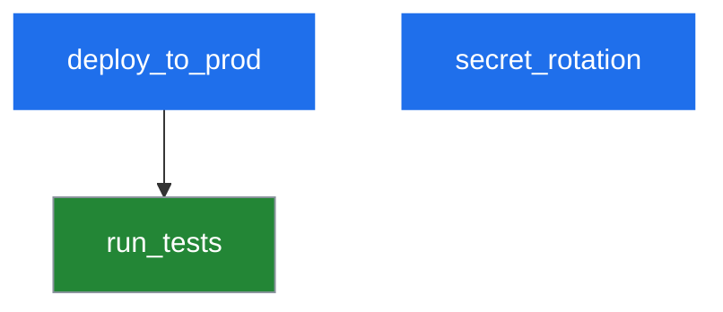

<div align="center">

# Hachi

**The governed personal agent**

_Governed personal agent: safety, spend, and self-improvement enforced by code, not by vibes._

[](https://www.python.org/downloads/)
[](LICENSE)
[](https://docs.astral.sh/ruff/)
[](docs/BENCHMARK.md)

</div>

---

## What is Hachi?

Every capability the agent has — or teaches itself — is a typed, versioned, lintable,
permission-scoped `.og` file you can diff and audit.  Every token has a budget the loop
enforces mid-turn.  Every shell command, path, URL, and memory write passes a guard that
exists in source code, not in a system prompt.

The category's two defining failures of 2026 — OpenClaw's marketplace poisoning crisis and
Hermes' agent that rewrites its own brain unsupervised — are the two things this architecture
was built to prevent.

| Problem | How Hachi solves it |
|---------|-----------------------|
| **Runaway token spend** | Per-session _and_ per-turn cost/token caps enforced between LLM calls; lazy tool groups; prompt-cache-aware breakpoints. The $47-echo-loop story is structurally impossible under a turn cap. |
| **Ungoverned self-learning** | `save_skill` bumps semver and appends changelog instead of overwriting; lint + dense-budget rejection bounds what the agent may write; `::assertions` make learned procedures machine-checkable before execution; your manual edits are never silently overwritten. |
| **Exposed attack surface** | Gateway binds loopback with bearer-token support by default; a `security-audit` CLI runs with `--fail-on-medium` in CI; permission tiers gate filesystem/shell/MCP at call time — not as runtime prompts. |
| **Skill library context bloat** | ObjectGraph `.og` files are queryable at sub-file granularity: agents load a 30-token index, pull only the node a task needs. [Measured: **97.6% fewer tokens** vs dump-all](docs/BENCHMARK.md) (53 nodes, P@5 = 0.97, reproducible). |

> **Honest scope caveat:** below ~30 k tokens of total library content, a cached dump-all
> approach is competitive on token cost. ObjectGraph is built for libraries that grow past
> that threshold — sub-file node granularity matters when the library no longer fits in a
> single context window.

---

## Quickstart (one-liner install)

**macOS / Linux:**

```bash
curl -fsSL https://raw.githubusercontent.com/OpenGigantic/hachi/main/install.sh | bash
```

**Windows (PowerShell):**

```powershell
irm https://raw.githubusercontent.com/OpenGigantic/hachi/main/install.ps1 | iex
```

The installer bootstraps [`uv`](https://docs.astral.sh/uv/) (which manages Python for you),
fetches Hachi, installs dependencies, and launches the guided setup.  No prior Python
setup required.

**Already have Python tooling?** Install the published package directly:

```bash
pipx install hachi-og          # or: uv tool install hachi-og
hachi quickstart            # pick a provider + safety level
```

Already have the source? Just run the conversational setup:

```bash
uv run hachi quickstart   # pick a provider, validate your API key up front, choose a safety level
hachi                     # start chatting (no subcommand needed)
```

`quickstart` checks your provider API key **before** the first message (instead of failing
mid-conversation) — the most common first-run snag for new users.

### One-command gateway + web UI

```bash
hachi serve               # starts gateway on 127.0.0.1:8787 AND serves frontend/dist
```

`hachi serve` auto-generates a bearer token (saved to `~/.hachi/gateway-token`),
starts the REST gateway with an in-process agent runtime, and mounts the pre-built
web frontend at the root — one terminal, full stack.  Build the frontend first if
you're working from source:

```bash
npm run build --prefix frontend   # produces frontend/dist
hachi serve
```

---

## Why switch from what you're already using?

### From OpenClaw (their verified pains: bills, CVE-2026-25253, ClawHavoc marketplace poisoning)

1. **Spend is governed in the loop**, not by a user-remembered env var: per-session and
   per-turn cost/token caps enforced between LLM calls; live cost read-models in TUI/gateway.
2. **Exposure is opt-in, not default**: gateway binds loopback; bearer-token support; `security-audit`
   with `--fail-on-medium` in CI; permission tiers gate filesystem/shell/MCP at call time.
   (93.4% of OpenClaw instances ran without auth at the time of the CVE.)
3. **Skills are auditable artifacts**: typed blocks, lint with errors/warnings, semver+changelog,
   structural-injection escaping, RBAC scopes — the shape of an answer to ClawHavoc without a
   marketplace yet.

_Honest deltas: OpenClaw has 20+ channels vs Hachi's 4; a massive community and tutorial base;
markdown memory is simpler to hand-edit than `.og`. Concede simplicity, evaluate governance._

### From Hermes (their verified pains: Curator overwrites manual edits, audit found 4 Critical + 9 High, learning loop off by default)

Hermes proved demand for the learning agent — and shipped it ungoverned. Hachi has the same
loop (`save_skill` after novel tasks, hot-load, refine) with the governance Hermes users ask for:
versioned diffs instead of silent overwrites; lint advisories; machine-checkable `::assertions`
before execution; shell access that is permission-gated, not raw `bash -c`.

_Honest deltas: Hermes' FTS5 conversational recall + Honcho user modeling are ahead of Hachi's
Chroma recall in maturity. Hermes ships an autonomous Curator; Hachi deliberately lacks one —
position the absence as a choice._

### From Claude Code (now crossing into personal-assistant territory)

Don't fight the repo job — Claude Code wins it. The switch (or _addition_) argument is
sovereignty: Hachi is self-hosted, **provider-free** (Anthropic / OpenAI-compat / OpenRouter /
Groq / DeepSeek / Gemini / Ollama including fully local), channel-native, permission-tiered for
non-developer trust, with hard cost caps instead of subscription throttles.  For an
OpenAI-compatible client ecosystem it _is_ an endpoint.

_Honest deltas: Claude Code's model quality, integration polish, and Anthropic's distribution are
unmatched. A claude.ai subscriber happy inside that ecosystem has little reason to move — target
the self-host/multi-provider/cost-sensitive segment._

### From OpenCode

Same terminal sensibility, different job. Pitch Hachi as the _second_ agent on the box:
OpenCode writes the code, Hachi runs the life — and exposes an OpenAI-compatible API
OpenCode users can point tools at.

---

## Features

- **ObjectGraph (.og) Engine** — A structured, queryable, agent-native file format with 20+
  semantic tags; typed blocks (`::meta`, `::index`, `::dense`, `::full`, `::assertion`,
  `::edges`, `::steps`, `::changelog`) enable sub-file granular loading and deterministic skill
  execution. [Benchmark: 97.6% token savings, P@5 = 0.97, reproducible.](docs/BENCHMARK.md)
- **Permission Gating** — Declarative `device-permissions.og` manifest controlling filesystem,
  terminal, MCP access, and outbound scopes; guards run at call time, not as runtime prompts;
  permission tiers (lightning / guided / strict) for different trust levels.
- **Governed Self-Learning** — `save_skill` persists novel task solutions as versioned `.og`
  nodes with semver bumps and changelog entries; lint + dense-budget rejection bounds what the
  agent may write; `::assertions` make learned procedures machine-checkable before execution.
- **Turn Serialization** — Per-session `threading.Lock` prevents concurrent history corruption;
  queued messages surface a `session.busy` event so UIs can show queued state.
- **Textual Operator Console** — Rich local TUI with transcript, runtime timeline, setup flow,
  and operations views; Esc-interrupt during active turns; incremental streaming render.
- **Typed Gateway API** — FastAPI control plane for sessions, events, runtime read models,
  config, and setup; gateway binds loopback with bearer-token support by default.
- **Web Frontend Workspace** — TanStack Start frontend wired to gateway endpoints with generated
  OpenAPI client types.
- **Multi-Agent Delegation** — Sub-agents with isolated context windows, role-scoped
  ToolRegistries, and searchable delegation reports; results via `delegation_log`.
- **Prompt Caching** — Native Anthropic cache breakpoints on system prompts and tool schemas;
  cache-aware prompt split keeps per-turn token spend low on repeated tool loads.
- **Job Queue** — Runtime jobs tracked with retry/backoff, surfaced in gateway read models;
  memory writes go through the queue (no inline drain latency in the turn path).
- **Native Integrations** — Google Workspace (Gmail, Drive, Calendar), Notion, Slack — all via
  OAuth; credentials resolved lazily at call time, never at boot.
- **Universal REST Adapter** — Define any REST API in a `.og` file; Hachi auto-generates
  the tool; outbound requests scrubbed of leaked credentials before they leave the machine.
- **Browser Automation** — Real headless browser (`browse_web`, `browser_act`,
  `browser_screenshot`) for live web research; SSRF-guarded and permission-gated
  (`pip install 'hachi-og[browser]'` + `playwright install chromium`).
- **Vision Input** — `view_image` lets the agent reason about a local file or `http(s)` URL
  (PNG/JPEG/GIF/WebP); permission-gated and SSRF-guarded (Anthropic provider).
- **Voice Input/Output** — `transcribe_audio` (Whisper) + `speak_text` (TTS); both
  permission-gated, SSRF-guarded, degrade gracefully when no key is set.
- **Injection Defenses** — Untrusted web, REST, and MCP content spotlighted so injected
  instructions are treated as data, not commands; Slack/Discord sends scrubbed of credentials.
- **MCP Support** — Model Context Protocol servers for filesystem and external tools.
- **Skill Lifecycle** — Usage tracking, stale detection, lint CI gate, and analytics for all
  `.og` skills; `::changelog` diff entries for delta loading.
- **Long-Term Memory** — Semantic search vault (ChromaDB) with async prefetch and frozen session
  snapshots; memory writes through the job queue with failure surfaced via `jobs/failed`.
- **Security Audit Command** — Built-in `security-audit` CLI checks local runtime posture;
  CI runs with `--fail-on-medium` on PRs.
- **OpenTelemetry Tracing** — Opt-in spans for LLM and tool calls
  (`pip install 'hachi-og[tracing]'` + `HACHI_TRACING=true`); zero overhead when off.
- **Autonomous Skill Authoring** — The agent writes and refines its own `.og` skills
  (`save_skill`); import the wider ecosystem with `hachi skill import` (SKILL.md → `.og`).
- **Proactive Scheduling** — `hachi schedule add` runs tasks on cron/interval/once with
  delivery to chat or a webhook.
- **Multi-Channel + OpenAI-Compatible API** — Reach the agent from Telegram or any platform via
  a generic inbound webhook; point Open WebUI / LibreChat at `/v1/chat/completions`.
- **Outbound Slack & Discord** — The agent posts proactively via bot token or webhook;
  SSRF-guarded, credentials resolved lazily at call time.
- **Model Freedom** — Anthropic, OpenAI-compatible, OpenRouter (200+ models), and local Ollama
  — no lock-in.
- **Cost Controls** — Live token/cost tracking plus per-session budget caps and per-sender rate
  limits; turn cap enforces hard stop mid-conversation when the budget is reached.
- **Edit Undo** — File writes are snapshotted; `rollback_changes` restores the previous version.

> See **[docs/CONFIGURATION.md](docs/CONFIGURATION.md)** for the full environment-variable and
> settings reference.

---

## Quick Start

### Prerequisites

- Python 3.11+
- [uv](https://docs.astral.sh/uv/)
- An [Anthropic API key](https://console.anthropic.com/)
- Node.js 20+ (optional, for `frontend/` local development)

### Installation

```bash
# Clone the repository
git clone https://github.com/OpenGigantic/hachi.git
cd hachi

# Create/update the local environment and install the package
uv sync
```

### Configuration

```bash
# Set your Anthropic API key
# Windows (PowerShell)
$env:ANTHROPIC_API_KEY = "sk-ant-..."

# macOS / Linux
export ANTHROPIC_API_KEY="sk-ant-..."
```

### Run

```bash
# Just type hachi — no subcommand needed
hachi
```

Once installed, plain `hachi` launches the Textual assistant directly (same as
`hachi run`). Useful flags work on the bare command too:

```bash
hachi                 # start the assistant
hachi -c              # continue the most recent conversation (full context reload)
hachi -r              # pick a past session to resume
hachi --repl          # legacy Rich REPL
hachi --version       # print version
hachi -h              # list every command
```

The Textual console boots the agent in-process, so interactive permission approvals
and in-chat slash commands operate on the live session.  (The HTTP gateway used by the
web frontend lives behind `hachi gateway`.)

On first run, Hachi will:

1. Create the `~/.hachi/` workspace directory
2. Apply quick-start setup defaults and prepare provider/permission configuration
3. Copy default skill files to `~/.hachi/skills/`
4. Launch the Textual operator console, or resume setup if configuration is incomplete

#### Slash commands (type in the chat composer)

`/help` lists them all. Highlights: `/clear`, `/compact`, `/new`, `/sessions`,
`/model [name]`, `/memory <query>`, `/remember <fact>`, `/forget <query>`,
`/plan <task>`, `/deep-research <question>`, `/settings`, `/setup`, `/quit`.

### Common Commands

```bash
# Launch Textual UI (default — subcommand optional)
hachi
uv run hachi run

# Resume a conversation
hachi -c                # most recent session
hachi -r                # choose from a list

# Launch legacy REPL
uv run hachi run --repl
uv run hachi run-repl

# Run setup flow without starting a session
uv run hachi setup --tier lightning

# Inspect config and canonical paths
uv run hachi config --paths
uv run hachi config-validate --json   # validate settings + provider key (CI-friendly exit code)
uv run hachi models                    # list the provider's models (live), capped by allowed_models

# Manage secret storage metadata and health
uv run hachi secrets --list
uv run hachi secrets --check

# Inspect long-term memory (semantic search + collection stats)
uv run hachi memory search "what framework does this project use"
uv run hachi memory search "preferences" --profile   # user_profile collection
uv run hachi memory stats

# Environment and security diagnostics
uv run hachi doctor
uv run hachi doctor --json            # machine-readable diagnostics (CI/automation)
uv run hachi security-audit --json --fail-on-high

# Start standalone gateway server
uv run hachi gateway --host 127.0.0.1 --port 8787 --runtime

# Export OpenAPI contract for clients
uv run hachi gateway-openapi --output openapi/hachi-openapi.json

# Fastest first-run setup (conversational; validates your API key up front)
uv run hachi quickstart

# Skills: import SKILL.md, list, export, lint, benchmark, usage report
uv run hachi skill import ./my-skill.md
uv run hachi skill list
uv run hachi skill search "deploy to prod"     # Pass-1 routing: which skills match a query
uv run hachi skill show deploy_to_prod         # Pass-2 view: metadata + dense + token costs
uv run hachi skill changelog deploy_to_prod    # version + ::changelog entries (delta-load)
uv run hachi skill assert deploy_to_prod -p env=prod  # check ::assertion preconditions (CI gate)
uv run hachi skill graph                       # whole-library dependency graph
uv run hachi skill viz -f mermaid              # render the graph as Mermaid
uv run hachi skill viz -f dot -o skills.dot    # Graphviz source
uv run hachi skill viz -f html -o skills.html  # self-contained interactive graph
uv run hachi skill export deploy_to_prod -o deploy.og
uv run hachi skill lint ./my-skills/           # structure + ::dense token-budget check
uv run hachi skill report                      # which skills earn their keep vs. dead weight
uv run hachi skill benchmark                   # token savings (CI-enforced ≥80%)
uv run hachi skill benchmark --suite fast      # + retrieval quality M1
uv run hachi skill benchmark --suite full      # + cost M2, latency M4, pass-depth M7

# Proactive scheduling (cron / interval / one-shot)
uv run hachi schedule add "daily-brief" "Summarize my unread email" --cron "0 9 * * 1-5"
uv run hachi schedule list
uv run hachi schedule run-due

# Talk to the agent from Telegram — runs locally, no deploy
uv run hachi channel telegram --setup   # one-time: paste bot token + pick who can talk to it
uv run hachi channel telegram           # subsequent runs use the stored token + allowlist
```

#### Visualize the ObjectGraph

`.og` is an _object graph_, so you can see it. `skill viz` renders the typed `requires` graph
across your skills — colored by role, with entry-point **roots** (blue), dependency **cycles**
(red), and **missing** deps (dashed) highlighted.



### Gateway and Web Frontend

```bash
# Terminal 1: gateway
uv run hachi gateway --host 127.0.0.1 --port 8787 --runtime

# Terminal 2: frontend dev server
cd frontend
npm install
npm run dev
```

Gateway base URL: `http://127.0.0.1:8787`

Useful endpoints:

- `GET /health`
- `GET /readiness`
- `POST /sessions`
- `POST /sessions/{session_id}/messages`
- `GET /sessions/{session_id}/events`
- `GET /sessions/{session_id}/stream` — Server-Sent Events stream (replaces polling)
- `GET /runtime/events`
- `GET /config`
- `GET /setup`
- `POST /v1/chat/completions` — OpenAI-compatible (point Open WebUI / LibreChat here)
- `POST /channels/{channel}/inbound` — generic inbound webhook for any chat platform

### Docker Compose

The repository includes a two-service local stack:

- `hachi` (Python gateway service on `:8787`)
- `frontend` (web UI on `:5173`)

```bash
docker compose up --build
```

---

## Architecture

```
hachi/
├── src/hachi/
│   ├── cli/                  # CLI entry point (Typer)
│   │   └── main.py           # Run modes, gateway server commands, diagnostics
│   │
│   ├── core/                 # Core engine modules
│   │   ├── llm.py            # LLM abstraction layer (Anthropic, with prompt caching)
│   │   ├── loop.py           # Autonomous ReAct execution loop
│   │   ├── turn_context.py   # Immutable per-turn execution context
│   │   ├── memory.py         # Context window management, compaction, and sync jobs
│   │   ├── memory_vault.py   # Long-term semantic memory (ChromaDB)
│   │   ├── memory_guard.py   # Layered inbound memory threat scanning
│   │   ├── permissions.py    # Device permission gating engine
│   │   ├── mcp_client.py     # Model Context Protocol client
│   │   ├── integrations.py   # Direct integration runtime (SMTP, REST)
│   │   ├── rest_adapter.py   # Universal REST API adapter
│   │   ├── oauth.py          # Google OAuth2 flow management
│   │   ├── session_store.py  # Cross-session persistence (SQLite)
│   │   ├── runtime_events.py # Runtime event taxonomy
│   │   ├── runtime_read_models.py # Typed read models for TUI/gateway views
│   │   └── credential_vault.py  # Secure credential storage
│   │
│   ├── jobs/
│   │   └── queue.py          # Queue/worker primitives with retry/backoff
│   │
│   ├── og_engine/            # ObjectGraph (.og) parser & skill engine
│   │   ├── parser.py         # Full .og lexical parser (OGFile, OGNode, OGIndexEntry)
│   │   └── engine.py         # Skill indexing, search, and context resolution
│   │
│   ├── gateway/              # Typed control plane + orchestration
│   │   ├── control_plane.py  # Session protocol and gateway runtime interfaces
│   │   ├── fastapi_app.py    # HTTP routes and OpenAPI surface
│   │   ├── orchestrator.py   # Agent session factory + runtime wiring
│   │   └── workspace.py      # ~/.hachi/ directory and skill bootstrap
│   │
│   ├── integrations/         # Native platform integrations
│   │   ├── google/           # Gmail, Drive, Calendar
│   │   ├── notion/           # Notion pages & databases
│   │   └── slack/            # Slack messaging & workspace
│   │
│   ├── tools/                # LLM-callable tool definitions
│   │   ├── os_tools.py       # File I/O & terminal commands (permission-gated)
│   │   ├── og_tools.py       # search_skills, load_skill
│   │   ├── memory_tools.py   # Long-term memory tools
│   │   └── workflow_tools.py # Workflow control tools
│   │
│   └── tui/
│       └── app.py            # Textual operator console
│
├── src/hachi/default_skills/             # Built-in .og skill files
│   ├── general/                          # Everyday skills (email, QR codes, web apps)
│   ├── technical/                        # Developer skills (code review, debugging)
│   ├── google/                           # Google Workspace skills
│   ├── notion/                           # Notion integration skills
│   └── slack/                            # Slack integration skills
│
├── benchmarks/og_bench/                   # Reproducible benchmark suite
│   ├── metrics.py                         # M1/M2/M4/M7 metric implementations
│   └── data/s_real_results_v1.json        # Frozen S-real corpus results
├── frontend/                              # TanStack Start web frontend
├── openapi/
│   └── hachi-openapi.json                # Generated gateway OpenAPI contract
├── docker-compose.yml                    # Gateway + frontend local stack
├── Dockerfile                            # Gateway service image
├── AGENTS.md                             # Contributor guidance for coding agents
├── ObjectGraph_Complete_Specification.md   # Full .og format specification
├── pyproject.toml                          # Project metadata & dependencies
├── CONTRIBUTING.md                         # Contribution guidelines
└── LICENSE                                 # MIT License
```

---

## The ObjectGraph (.og) Format

ObjectGraph is a **structured, queryable, agent-native file format** for AI agent skill files.
It uses a familiar, Markdown-like syntax with added `::` semantic blocks, so skills stay
human-readable and are low-effort to author and port.

### Why Not Markdown?

|                            | Markdown               | ObjectGraph (.og)                  |
| -------------------------- | ---------------------- | ---------------------------------- |
| **Reading Model**          | Full file every time   | 3-pass: Index → Dense → Full       |
| **Token Cost (per query)** | Whole file every time  | Only the node(s) needed¹           |
| **Query Routing**          | None (read everything) | `::index` routing table            |
| **Compression**            | None                   | `::dense` keyword blocks           |
| **Validation**             | Prompt-dependent       | `::assertion` blocks               |
| **Multi-Agent RBAC**       | None                   | `scope` attribute per node         |
| **Dependency Tracking**    | None                   | `::edges` with typed relationships |
| **Delta Loading**          | Full re-read           | `::changelog` diff entries         |

¹ On the bundled 53-node skill set: 97.6% fewer skill-loading tokens vs dump-all (208 vs 8,726
tokens); P@5 retrieval = 0.97; 77% of queries resolve at Pass 1. Reproducible via
[`tests/test_og_benchmark.py`](tests/test_og_benchmark.py) — see [docs/BENCHMARK.md](docs/BENCHMARK.md)
for methodology, honest crossover caveat, and full M1/M2/M4/M7 results.

**How is this different from Anthropic Agent Skills or MCP?** Progressive disclosure on its own
isn't unique — Anthropic Agent Skills load skill metadata first and the full `SKILL.md` only when
it's relevant, and MCP can filter which tools are exposed. ObjectGraph goes _below the file level_:
it routes and loads individual **nodes** within a skill, follows typed `::edges` (`->[:requires]`)
to pull only the dependencies a task actually needs, and pairs this with agent-authored,
self-improving skills and usage analytics. The bet is that context bloat is a **format** problem,
not only a retrieval one.

### Example `.og` File

```
::meta
  title: Deployment Skill
  version: 1.0.0
  domain: deployment|devops
  scope: all

::index
  # node-id       | type    | scope  | conf | keywords
  install          | step    | all    | 0.99 | install, setup, uv
  deploy-prod      | step    | all    | 0.95 | deploy, production, release
  rollback         | step    | all    | 0.93 | rollback, revert, undo

::node[install]
->[:role=skill]
->[:keywords=install, setup, uv, python]
::dense
python3.11+|uv|sync|project-env|dependencies
::full
Ensure Python 3.11+ and uv are installed. Sync dependencies
and package metadata into the local project environment.
::steps
1. uv sync
2. uv run python --version
3. uv run hachi --help
::assertion
  trigger: after[install]
  check: command('uv run python -c "import typer"') exits 0
  on-fail: ->[:retry] install
  on-pass: ->[:proceed] deploy-prod
::edges
  ->[:precedes] deploy-prod
  ->[:requires] concept-virtualenv
```

For the complete specification, see [ObjectGraph_Complete_Specification.md](ObjectGraph_Complete_Specification.md).

---

## Configuration

### Workspace Structure

Hachi resolves paths with `platformdirs` (config/data/state), while still importing from
legacy `~/.hachi/` when needed.

```bash
uv run hachi config --paths
```

Key path roles:

```
config_dir/
├── settings.toml              # Main resolved config (provider, agent, permissions, memory)
├── brain.og                   # Core agent identity & behavioral rules
└── device-permissions.og      # Filesystem & terminal access policy

data_dir/
├── skills/                    # User and installed .og skill files
└── chroma_vault/              # Semantic memory store

state_dir/
├── sessions.db                # Session/message persistence
├── tui_state.db               # Textual UI state
└── onboarding_state.json      # Setup progress
```

### Agent Configuration (`settings.toml`)

```toml
[provider]
kind = "anthropic"
model = "claude-haiku-4-5"
api_key_env = "ANTHROPIC_API_KEY"

[agent]
temperature = 0.0
max_tokens = 8192

[permissions]
tier = "guided"

[memory]
enable_session_history = true
enable_semantic_memory = true
```

### Device Permissions (`device-permissions.og`)

```
::node[terminal]
->[:role=permission]
::config
enabled=true
allowed_commands=*
blocked_commands=rm -rf, format, shutdown, taskkill
timeout=120
```

---

## Roadmap

- [x] **Governed Turn Execution** — per-session serialization lock; iteration-limit graceful exit
- [x] **Streaming** — `generate_stream` provider seam; `text_delta` loop events; TUI incremental render; Esc-interrupt; SSE + OpenAI `stream:true`
- [x] **ObjectGraph Engine v2** — qualified node IDs + collision error; retrieval v2 (BM25 + stopword-guarded tokenization); P@5 = 0.97 on the S-real corpus; pass-depth counters (M7)
- [x] **Shipped-Skill Compliance** — all 53 default skills have `::meta` + `::index`; lint CI gate blocks on errors
- [x] **Durable Job Queue** — SQLite persistence; resident worker thread; memory writes off the turn path
- [x] **Reproducible Benchmark Suite** — `skill benchmark --suite {token|fast|full}`; M1/M2/M4/M7 metrics; CI gates token savings + retrieval quality per-PR; frozen S-real results in `benchmarks/og_bench/data/`
- [x] **Security Posture** — `security-audit` CLI; gateway loopback-by-default + bearer-token support; `--fail-on-medium` in CI
- [x] **Frontend Contract** — OpenAPI export; generated TypeScript client; CI enforces contract currency
- [ ] **`.ogpack` Format + Consent Sheets** — install/update packs with scope-diff re-prompt (no install-time code execution)
- [ ] **Workflow Composer** — speech → preview card → approve → scheduled artifact on disk
- [ ] **TUI Governance Surfaces** — status strip, Spend screen, Ops timeline
- [ ] **Memory Graph (M1)** — typed extractor; episode nodes; FTS5 index over `memory/*.og` files

---

## Contributing

We welcome contributions! Please read our [Contributing Guide](CONTRIBUTING.md) for details on:

- Development setup
- Code style and commit conventions
- How to write `.og` skill files
- Pull request process

---

## License

This project is licensed under the MIT License — see the [LICENSE](LICENSE) file for details.

---

<div align="center">
  <sub>Built by Open Gigantic</sub>
</div>
